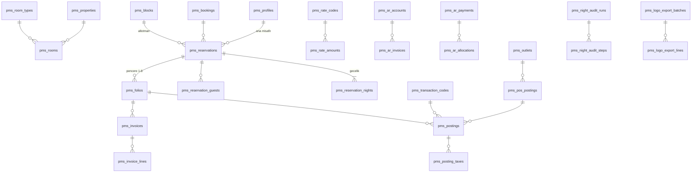

# 3. Veritabanı tasarımı

MySQL 8, InnoDB, `utf8mb4_unicode_ci`. Tüm iş tabloları **`pms_`** önekiyle (RS ONE ile birleşmede çakışma olmasın diye).
Laravel'in kendi tabloları (`users`, `jobs`, `cache`, `sessions`, `failed_jobs`, `personal_access_tokens`) öneksiz kalır.

## 3.0 Ortak kurallar

| Kural | Açıklama |
|---|---|
| Birincil anahtar | `id BIGINT UNSIGNED AUTO_INCREMENT` |
| Zaman | `created_at`, `updated_at` (`TIMESTAMP`); tanım tablolarında `deleted_at` (yumuşak silme) |
| Kim yaptı | `created_by`, `updated_by` → `users.id` (gerektiği tablolarda) |
| Tesis | İş tablolarında `property_id` → `pms_properties.id`, sorgularda her zaman ilk filtre |
| Para | `DECIMAL(14,2)`, kur `DECIMAL(18,8)`, oran `DECIMAL(8,4)`; para birimi `CHAR(3)` |
| Tarih | Konaklama ve iş günü `DATE`; anlık olaylar `TIMESTAMP` |
| Durum alanları | `VARCHAR(20)` + uygulamada PHP enum (MySQL `ENUM` kullanılmaz; yeni değer eklemek migration gerektirmesin) |
| Mali tablolar | `pms_postings`, `pms_posting_taxes`, `pms_invoices`, `pms_invoice_lines`, `pms_ar_*`, `pms_logo_export_*`: **silme yok, değiştirme yok**; yalnız ters kayıt |
| Dış kaynaklı kayıt | `idempotency_key VARCHAR(100) UNIQUE NULL` |
| Eski sistem | Fidelio'dan aktarılan her kayıtta `legacy_system VARCHAR(20)`, `legacy_id VARCHAR(50)` + birleşik indeks. Zorunlu tablolar: profiller, rezervasyonlar, gecelik satırlar, folyolar, kayıtlar, işlem kodları, fiyat kodları, oda tipleri, odalar, para birimleri, cari hesaplar, bloklar |
| Kişisel veri | Kimlik no, kart bilgisi şifreli (`encrypted` cast); aranacak alanların yanında `*_hash` (SHA-256) |

> **Fidelio uyumu:** Bu tasarım, otelin Suite8 veritabanındaki view'lar (`V8LIVE.PRO_*`) ve canlı departman kodlarıyla karşılaştırılarak düzenlendi.
> Fidelio karşılığı olan alanlar `‹F: …›` ile işaretlidir. Ayrıntılı eşleme: [fidelio/eslesme.md](fidelio/eslesme.md).

Aşağıda tablolar **modül modül** verilmiştir. Gösterim: `kolon  TİP  [boş olabilir?]  — açıklama`.
`FK` yabancı anahtar, `UQ` benzersiz, `IX` indeks.

---

## A. Çekirdek

### pms_properties — Tesisler
```
id
code                 VARCHAR(10)   UQ        — Kısa kod (RCK)
name                 VARCHAR(150)
legal_name           VARCHAR(200)  null      — Fatura üzerindeki ünvan
tax_office           VARCHAR(100)  null
tax_number           VARCHAR(30)   null
address              VARCHAR(500)  null
city                 VARCHAR(100)  null
country_code         CHAR(2)                 — CY / TR
phone, email, website VARCHAR      null
timezone             VARCHAR(50)             — Asia/Nicosia
base_currency        CHAR(3)                 — Tesis ana para birimi (TRY)
check_in_time        TIME                    — Standart giriş saati
check_out_time       TIME
current_business_date DATE                   — Açık iş günü (gece kapanışı ilerletir)
night_audit_time     TIME          null      — Otomatik kapanış saati (boşsa yalnız elle)
exchange_diff_transaction_code_id FK null    — Kur farkı kodu ‹F: 550 Kur Farki›
star_rating          TINYINT       null
rsone_business_id    BIGINT        null      — RS ONE businesses.id
is_active            BOOLEAN
timestamps, deleted_at
```

### users (Laravel) — Kullanıcılar
```
id, name, email UQ, password, phone null, locale (tr), is_active,
last_login_at null, rsone_user_id null, remember_token, timestamps
```

### pms_roles / pms_permissions / pms_role_permissions / pms_user_properties — Yetki
```
pms_roles:            id, code UQ (front_office, cashier, night_auditor, housekeeping, revenue, accounting, manager, admin), name
pms_permissions:      id, code UQ (folio.post, folio.reverse, folio.transfer, rate.override, reservation.cancel,
                      night_audit.run, cashier.close, ar.allocate, room.move, profile.merge, ...), name, group
pms_role_permissions: role_id FK, permission_id FK                         UQ(role_id, permission_id)
pms_user_properties:  id, user_id FK, property_id FK, role_id FK,
                      max_discount_pct DECIMAL(5,2) null, max_reversal_amount DECIMAL(14,2) null   — kişi bazlı sınır
                                                                            UQ(user_id, property_id, role_id)
```

### pms_settings — Ayarlar
```
id, property_id null (null = genel), key VARCHAR(100), value JSON, updated_by, timestamps   UQ(property_id, key)
```

### pms_business_dates — İş günleri
```
id
property_id          FK
business_date        DATE                    UQ(property_id, business_date)
status               VARCHAR(20)             — open / closing / closed
opened_at            TIMESTAMP
closed_at            TIMESTAMP     null
closed_by            FK users      null
night_audit_run_id   FK            null
```

### pms_currencies / pms_exchange_rates — Döviz
```
pms_currencies:      code CHAR(3) PK (ISO3), short_code VARCHAR(3) ‹F: ZCUR_SHORTDESC›, name, symbol,
                     decimals TINYINT ‹F: ZCUR_DECDIGITS›, is_active, sort ‹F: ZCUR_DISPLORDER›,
                     rate_period VARCHAR(10) — daily / monthly ‹F: ZCUR_MONTHLY›, legacy_id ‹F: ZCUR_ID›
pms_exchange_rates:  id, property_id FK, currency_code FK, business_date DATE ‹F: WDAT_DATE›,
                     rate_type VARCHAR(10) — day / month / year ‹F: EXCH_RATE_DAY/MONTH/YEAR›,
                     buy_rate, sell_rate, posting_rate DECIMAL(18,8)  — folyoda kullanılan kur,
                     exchange_fee_pct DECIMAL(5,2) null — Döviz bozdurma komisyonu ‹F: Exchange Rate Fee›,
                     max_exchange_amount DECIMAL(14,2) null — Tek işlemde azami bozdurma,
                     source VARCHAR(20) (manual / central_bank / fidelio), created_by, timestamps
                     UQ(property_id, currency_code, business_date, rate_type)
```

### pms_taxes — Vergiler
```
id, property_id FK, code VARCHAR(10), name,
calc_type            VARCHAR(20)             — percent / per_night / per_person_night
rate                 DECIMAL(8,4)  null      — Yüzde
amount               DECIMAL(14,2) null      — Sabit tutar (konaklama vergisi gibi)
is_inclusive         BOOLEAN                 — Fiyata dahil mi
logo_tax_code        VARCHAR(20)   null
valid_from, valid_to DATE          null
timestamps, deleted_at                       UQ(property_id, code)
```
> KKTC'deki güncel KDV ve konaklama vergisi oranları kurulumda girilecek; tasarım oranı sabitlemez.

### pms_number_sequences — Numara serileri
```
id, property_id FK,
type                 VARCHAR(30)             — invoice / credit_note / proforma / receipt / confirmation / folio / ar_invoice / cancellation
prefix               VARCHAR(10)   null
next_number          BIGINT
padding              TINYINT
reset_yearly         BOOLEAN
current_year         SMALLINT      null      UQ(property_id, type)
```
Numara alma: `SELECT … FOR UPDATE` ile, aynı işlem içinde; boşluk bırakmaz.

### pms_reason_codes — Gerekçe kodları
```
id, property_id FK,
category             VARCHAR(30)             — cancel / no_show / room_move / rate_override / posting_reversal /
                                               discount / outage / waive / complimentary / early_departure
code VARCHAR(10), name, requires_note BOOLEAN, is_active                UQ(property_id, category, code)
```

### pms_countries — Ülkeler
```
code CHAR(2) PK, iso3 CHAR(3), fidelio_code VARCHAR(3) ‹F: COUNTRY/NATION›, name_tr, name_en, nationality_tr,
kbs_code VARCHAR(10) null ‹F: UYRUK_KODU›, phone_prefix, legacy_id ‹F: XCOU_ID›
```

### pms_audit_logs — Denetim kaydı
```
id, property_id null, user_id null,
auditable_type VARCHAR(100), auditable_id BIGINT,
action               VARCHAR(30)             — created / updated / deleted / status_changed / reversed / printed / exported
old_values, new_values JSON null
reason_code_id FK null, note VARCHAR(500) null,
business_date DATE null, ip VARCHAR(45), user_agent VARCHAR(255), created_at
IX(auditable_type, auditable_id), IX(property_id, created_at)
```

---

## B. Oda envanteri

### pms_buildings / pms_floors
```
pms_buildings: id, property_id FK, code, name, sort, timestamps, deleted_at          UQ(property_id, code)
pms_floors:    id, property_id FK, building_id FK null, code, name, sort, timestamps UQ(property_id, building_id, code)
```

### pms_room_classes — Oda sınıfları / otel segmenti (Standart, Suit, Villa) ‹F: YCAD›
```
id, property_id FK, code VARCHAR(10) ‹F: HOTELSEGMENT›, name ‹F: YCAD_LONGDESC›, sort, legacy_id ‹F: YCAD_ID›,
timestamps, deleted_at                                                               UQ(property_id, code)
```

### pms_room_types — Oda tipleri
```
id
property_id          FK
room_class_id        FK            null
code                 VARCHAR(10)             UQ(property_id, code) — DBL, TRP, SUI ‹F: YCAT_SHORTDESC›
name                 VARCHAR(100)                                     ‹F: YCAT_LONGDESC›
short_name           VARCHAR(30)   null
description          TEXT          null
default_adults       TINYINT                 — Fiyatın baz aldığı kişi sayısı
max_adults           TINYINT
max_children         TINYINT
max_occupancy        TINYINT
max_extra_beds       TINYINT
bed_type             VARCHAR(30)   null
size_m2              DECIMAL(6,2)  null
view                 VARCHAR(50)   null
color                CHAR(7)       null      — Oda planında renk
is_pseudo            BOOLEAN                 — Sanal (PM) oda tipi; satılmaz, envantere girmez ‹F: YCAT_NOTINAVL›
beds                 TINYINT                 — Oda başı yatak (yatak bazlı istatistik) ‹F: NOOFBEDS›
legacy_id            VARCHAR(50)   null      ‹F: YCAT_ID›
is_bookable_online   BOOLEAN
sort                 SMALLINT
is_active            BOOLEAN
timestamps, deleted_at
```

### pms_rooms — Odalar
```
id
property_id          FK
room_type_id         FK
building_id          FK            null
floor_id             FK            null
hk_section_id        FK            null      — Kat hizmetleri bölümü
number               VARCHAR(10)             UQ(property_id, number)
name                 VARCHAR(100)  null
description          VARCHAR(500)  null
max_occupancy        TINYINT       null      — Odaya özel sınır (boşsa tipten)
hk_credits           DECIMAL(4,1)            — Temizlik puanı (görev dağıtımı)
is_pseudo            BOOLEAN                 — PM / master / house odası
is_smoking           BOOLEAN
is_accessible        BOOLEAN
fo_status            VARCHAR(20)             — vacant / occupied        (önbellek, rezervasyondan türetilir)
hk_status            VARCHAR(20)             — clean / dirty / inspected / pickup
service_status       VARCHAR(20)             — in_service / out_of_order / out_of_service
current_reservation_id FK          null      — Şu an içerideki rezervasyon (önbellek)
hk_status_changed_at TIMESTAMP     null
sort                 SMALLINT
is_active            BOOLEAN
timestamps, deleted_at
IX(property_id, room_type_id), IX(property_id, hk_status)
```

### pms_room_features / pms_room_feature_room — Oda özellikleri
```
pms_room_features:     id, property_id FK, code, name (Deniz manzarası, Balkon, Küvet...)
pms_room_feature_room: room_id FK, room_feature_id FK      PK(room_id, room_feature_id)
```

### pms_room_connections — Bağlantılı odalar (QloApps)
```
id, room_id FK, connected_room_id FK, created_at          UQ(room_id, connected_room_id)  — iki yönlü kaydedilir
```

### pms_room_outages — Arızalı / kullanım dışı odalar
```
id, property_id FK, room_id FK,
type                 VARCHAR(5)              — ooo (envanterden düşer) / oos (satılabilir, uyarı)
date_from            DATE
date_to              DATE                    — Hariç (çıkış mantığı)
reason_code_id       FK
note                 VARCHAR(500)  null
return_hk_status     VARCHAR(20)             — Bitince oda durumu (dirty / clean)
rsone_task_id        BIGINT        null      — RS ONE teknik servis kaydı
released_at, released_by           null
created_by, timestamps
IX(property_id, date_from, date_to)
```

### pms_media — Görseller
```
id, property_id FK, mediable_type, mediable_id, path, category, caption null, sort, timestamps
```

---

## C. Kodlar (Fidelio mantığı)

```
pms_market_groups:     id, property_id, code, name, sort                                  — Bireysel / Grup / Kurumsal
pms_market_segments:   id, property_id, market_group_id FK, code VARCHAR(3), name, is_active, sort ‹F: MARKETCODE›
pms_source_codes:      id, property_id, code VARCHAR(3), name                              ‹F: SOURCECODE›
pms_channel_codes:     id, property_id, code VARCHAR(3), name,
                       type VARCHAR(20) — direct / phone / web / ota / gds / agency / walk_in / rsone ‹F: CHANNELCODE›
pms_reservation_types: id, property_id, code, name,
                       deducts_inventory BOOLEAN  — Envanterden düşer mi (opsiyon/kesin)
                       is_guaranteed BOOLEAN, requires_deposit BOOLEAN,
                       release_hour TIME null     — 18:00 rezervasyonu gibi
pms_vip_levels:        id, property_id, code VARCHAR(3), name, color                     ‹F: VIPCODE›
pms_special_requests:  id, property_id, category VARCHAR(30), code, name                  — Tercih ve istek listesi
```
Hepsinde: `timestamps, deleted_at`, `UQ(property_id, code)`.

---

## D. Profiller

### pms_profiles — Misafir, şirket, acente, kaynak, grup
```
id
property_id          FK            null      — null: tüm tesislerde ortak (zincir)
type                 VARCHAR(20)             — individual / company / travel_agent / source / group / vendor /
                                               meeting_planner / contact ‹F: PROFILE_INTERNALCATEGORY 1–6›
status               VARCHAR(20)             — active / inactive / terminated / merged / blacklisted ‹F: ACTIVE_STATUS›
title                VARCHAR(20)   null
salutation           VARCHAR(30)   null      — Adres hitabı ‹F: ADDRESSGREETING›
letter_greeting      VARCHAR(60)   null      — Mektup hitabı ‹F: LETTERGREETING›
first_name           VARCHAR(100)  null
middle_name          VARCHAR(100)  null
last_name            VARCHAR(100)  null      ‹F: NAME1 (bireysel)›
company_name         VARCHAR(200)  null      — Şirket / acente / grup adı
display_name         VARCHAR(250)            — Aramada kullanılan birleşik ad
gender               VARCHAR(10)   null
birth_date           DATE          null
birth_place          VARCHAR(100)  null
father_name          VARCHAR(60)   null      ‹F: BABAADI›
mother_name          VARCHAR(60)   null      ‹F: ANAADI›
marital_status       VARCHAR(20)   null      ‹F: MEDENIHALI›
occupation           VARCHAR(100)  null      ‹F: ISI›
nationality_code     CHAR(2)       null
language_code        CHAR(2)       null
vip_level_id         FK            null
tax_office           VARCHAR(100)  null
tax_number           VARCHAR(30)   null      — Şirket/acente vergi no
iata_code            VARCHAR(20)   null      — Acente
commission_pct       DECIMAL(5,2)  null      — Acente komisyonu
ar_account_id        FK            null      — Cari hesabı (şirket/acente)
default_rate_code_id FK            null
default_market_segment_id FK       null
default_source_code_id    FK       null
blacklist_reason     VARCHAR(500)  null
marketing_consent    BOOLEAN
marketing_consent_at TIMESTAMP     null
marketing_consent_source VARCHAR(30) null    — check_in / web / phone / rsone
photo_path           VARCHAR(500)  null
privacy_notice_at    TIMESTAMP     null      — Aydınlatma metni onayı
rsone_client_id      BIGINT        null      — RS ONE clients.id
merged_into_id       FK self       null      — Birleştirilen mükerrer kayıt ‹F: MERGEDTO_PROFILE_ID›
merged_at            TIMESTAMP     null      ‹F: MERGETIME›
primary_contact_profile_id FK self null      — Şirketin ana irtibat kişisi ‹F: PRIMARY_CONTACT_ID›
wedding_date         DATE          null      ‹F: WEDDINGDAY›
no_mailing           BOOLEAN                 — Posta gönderilmez ‹F: NOMAILING›
no_emailing          BOOLEAN                 — E-posta gönderilmez ‹F: NOEMAILING›
store_private_data   BOOLEAN                 — Kişisel veri saklama izni ‹F: STOREPRIVATEDATA›
origin_hotel_name    VARCHAR(200)  null      — Profilin açıldığı otel ‹F: ORIGINATED_HOTEL_NAME›
origin_hotel_legacy_id VARCHAR(50) null      ‹F: ORIGINATED_HOTEL_ID›
legacy_global_id     VARCHAR(50)   null      — Fidelio merkezi profil no ‹F: PROFILE_GLOBALID›
legacy_created_by, legacy_updated_by VARCHAR(100) null — Fidelio kullanıcı adı
legacy_system, legacy_id           null
created_by, updated_by, timestamps, deleted_at
IX(property_id, type, display_name), IX(last_name, first_name), IX(tax_number), IX(rsone_client_id), IX(legacy_system, legacy_id)
FULLTEXT(display_name)
```

### Profil alt tabloları
```
pms_profile_addresses:      id, profile_id FK, type (home/business/billing), line1, line2 null, line3 null,
                            district null, city null, state null, postal_code null, country_code, is_primary
                            ‹F: STREET1–3, CITY, ZIPCODE, STATE_*, COUNTRY›
pms_profile_communications: id, profile_id FK, type (mobile/phone/email/fax/web), value,
                            value_normalized  — E.164 telefon / küçük harf e-posta (RS ONE eşleşmesi)
                            is_primary, marketing_allowed                          IX(value_normalized)
pms_profile_identities:     id, profile_id FK, document_type (kktc_id/tc_id/passport/id_card/driving_license),
                            document_number (şifreli), document_number_hash, serial_number null ‹F: KIMLIKSERINO›,
                            issuing_country, issue_place null,
                            registry JSON null  — Nüfus kaydı: il, ilçe, mahalle, cilt, aile sıra, sıra no ‹F: NUFUS*›
                            issue_date null, expiry_date null, file_path null (şifreli depolama),
                            verified_at null, verified_by null                     IX(document_number_hash)
pms_profile_relations:      id, profile_id FK, related_profile_id FK, relation (employee_of/booker_for/family/spouse/child/assistant)
                            ‹F: PRO_ISV_IND_FAM_LINKS›
pms_profile_preferences:    id, profile_id FK, special_request_id FK, note null
pms_membership_types:       id, property_id, code VARCHAR(3) ‹F: SHORTDESC›, name ‹F: LONGDESC›,
                            role (ar_number/iata/vat/loyalty/corporate_id/other) ‹F: CARDROLE›
pms_profile_memberships:    id, profile_id FK, membership_type_id FK, number ‹F: CARDVALUE›, level null, valid_until null
pms_profile_negotiated_rates: id, profile_id FK, property_id FK, rate_code_id FK, valid_from null, valid_to null
pms_note_categories:        id, property_id, code, name, area (general/front_office/housekeeping/accounting/sales) ‹F: Note Categories›
pms_notes:                  id, property_id, notable_type, notable_id (profil / rezervasyon / blok / folyo / cari),
                            note_category_id FK, note TEXT, is_internal, show_on_check_in, created_by, timestamps
pms_profile_stats:          profile_id PK, first_stay_date, last_stay_date, stays, nights, room_revenue,
                            other_revenue, total_revenue, cancellations, no_shows, updated_at
                            — Gece kapanışında güncellenir; Fidelio geçmişi de buraya toplanır
```

---

## E. Fiyat ve müsaitlik

### pms_seasons / pms_season_dates
```
pms_seasons:      id, property_id, code, name, color, sort
pms_season_dates: id, season_id FK, date_from DATE, date_to DATE                     IX(date_from, date_to)
```

### pms_rate_categories — Fiyat kategorileri (BAR, Kurumsal, Acente, Paket)
```
id, property_id, code, name, sort
```

### pms_rate_codes — Fiyat kodları
```
id
property_id          FK
rate_category_id     FK            null
code                 VARCHAR(20)             UQ(property_id, code)
name                 VARCHAR(100)
description          TEXT          null
currency_code        CHAR(3)
package_id           FK            null      — Pansiyon (BB, HB, FB, AI)
package_nights       SMALLINT      null      — Sabit süreli paket (ör. 7 gece tatil paketi)
is_tax_inclusive     BOOLEAN
is_public            BOOLEAN                 — Çevrimiçi satışta görünür
is_negotiated        BOOLEAN                 — Yalnız anlaşmalı profillere
parent_rate_code_id  FK self       null      — Türetilmiş fiyat
derive_type          VARCHAR(10)   null      — percent / amount
derive_value         DECIMAL(14,2) null      — −10 (%10 indirim) gibi
rounding             VARCHAR(10)   null      — none / 1 / 5 / 10
room_transaction_code_id FK                  — Oda geliri işlem kodu
default_market_segment_id, default_source_code_id FK null
cancellation_policy_id, deposit_policy_id      FK null
min_los, max_los     SMALLINT      null
valid_from, valid_to DATE          null
is_active, sort, timestamps, deleted_at
```

### pms_rate_code_room_types — Fiyat kodunun sattığı oda tipleri
```
rate_code_id FK, room_type_id FK                                           PK(rate_code_id, room_type_id)
```

### pms_rate_amounts — Fiyat tablosu
```
id
rate_code_id         FK
room_type_id         FK
day_type_id          FK            null      — Gün tipine özel fiyat (hafta sonu, etkinlik günü) ‹F: Day Types›
date_from, date_to   DATE                    — Dahil
weekdays             TINYINT                 — Bit maskesi: Pzt=1 … Paz=64; 127 = her gün
price_1, price_2, price_3, price_4  DECIMAL(14,2) null — 1..4 yetişkin fiyatı (oda başı)
extra_adult          DECIMAL(14,2) null
child_band_1, child_band_2, child_band_3  DECIMAL(14,2) null — Yaş bandına göre çocuk fiyatı
extra_bed            DECIMAL(14,2) null
created_by, timestamps
IX(rate_code_id, room_type_id, date_from, date_to)
```
Çözüm kuralı: Tarihi kapsayan, haftanın gününe uyan **en dar** aralık; eşitse **en son eklenen**.
Türetilmiş fiyat kodunda tablo boşsa üst koddan hesaplanır.

### pms_child_age_bands
```
id, property_id, band TINYINT (1-3), age_from TINYINT, age_to TINYINT, name     UQ(property_id, band)
```

### pms_packages / pms_package_elements — Pansiyon ve ek paketler
```
pms_packages:         id, property_id, code (BB/HB/FB/AI/SPA1), name,
                      type (board/addon), posting_rhythm (every_night/arrival/departure/once),
                      is_included_in_rate BOOLEAN   — Oda fiyatının içinden mi ayrılır
                      timestamps, deleted_at
pms_package_elements: id, package_id FK, transaction_code_id FK  — Kahvaltı geliri gibi
                      calc (per_room/per_person/per_adult/per_child), amount_adult, amount_child,
                      is_allowance BOOLEAN          — Hak; Simphony'de kullanıldıkça düşülür
                      outlet_id FK null             — Hakkın kullanılabileceği outlet
```
Gece kapanışında paketli oda ücreti: *oda geliri = gecelik fiyat − paket elemanları*; her eleman kendi işlem koduna ayrı kayıt.

### pms_rate_restrictions — Günlük kısıtlar
```
id, property_id, rate_code_id FK null, room_type_id FK null, date DATE,
is_closed, closed_to_arrival, closed_to_departure BOOLEAN,
min_los, max_los, min_advance_days, max_advance_days SMALLINT null, updated_by, timestamps
UQ(property_id, rate_code_id, room_type_id, date)
```

### pms_inventory_daily — Günlük müsaitlik (önbellek tablosu)
```
id, property_id, room_type_id FK, date DATE,
physical_rooms       SMALLINT                — Aktif oda sayısı
out_of_order         SMALLINT
sold_definite        SMALLINT                — Envanterden düşen rezervasyonlar
sold_tentative       SMALLINT                — Opsiyonlar (envanterden düşmeyen)
block_remaining_definite  SMALLINT           — Kesin blokta kalan ‹F: DEFBLOCKS›
block_remaining_tentative SMALLINT           — Opsiyon blokta kalan ‹F: TENTBLOCKS›
overbooking_limit    SMALLINT
out_of_service       SMALLINT                — Bilgi (envanterden düşmez) ‹F: OOSROOMS›
available            SMALLINT                — physical − ooo − definite − block_remaining_definite
updated_at
UQ(property_id, room_type_id, date)
```
Rezervasyon/blok/arıza her değiştiğinde aynı işlem içinde güncellenir; `pms:rebuild-inventory` komutu sıfırdan hesaplar.

### pms_cancellation_policies / pms_deposit_policies
```
pms_cancellation_policies:      id, property_id, code, name, description
pms_cancellation_policy_rules:  id, policy_id FK, days_before_arrival SMALLINT, hour TIME null,
                                penalty_type (nights/percent/amount), penalty_value, applies_to_no_show BOOLEAN
pms_deposit_policies:           id, property_id, code, name
pms_deposit_policy_rules:       id, policy_id FK, due_type (on_booking/days_before_arrival), due_days,
                                amount_type (percent/nights/amount), amount_value
```

---

### pms_promotions / pms_reservation_night_promotions — Promosyonlar ‹F: PRO_ISV_PROMOTIONS›
```
pms_promotions:                   id, property_id, code VARCHAR(3), name,
                                  promo_code VARCHAR(30) null — Çevrimiçi indirim kodu, max_uses null, times_used,
                                  rule_code VARCHAR(3), rule_name,
                                  rule_type (free_nights/percent/amount)  — Suite8: 1 Aksiyon (gün indirimi), 2 Erken rezervasyon (%)
                                  value DECIMAL(14,2), stay_from, stay_to, booking_from, booking_to DATE null,
                                  min_nights SMALLINT null, is_active, timestamps, deleted_at
pms_reservation_night_promotions: id, reservation_night_id FK, promotion_id FK,
                                  amount DECIMAL(14,2), foreign_amount DECIMAL(14,2) null
```

### pms_rebate_codes / pms_rebate_code_rules / pms_reservation_rebates — İndirim kuralları ‹F: ZRDF, Rebate›
Suite8'de *rebate*, rezervasyona bağlanan ve kayıt atılırken otomatik uygulanan indirim kuralıdır
(ör. konaklamada %10, yiyecek-içecekte %8, havuz girişi 3 kez ücretsiz).
```
pms_rebate_codes:       id, property_id, code VARCHAR(10) ‹F: ZRDF_SHORTDESC›, name ‹F: ZRDF_LONGDESC›,
                        barcode_prefix null, is_active, legacy_id, timestamps, deleted_at
pms_rebate_code_rules:  id, rebate_code_id FK, transaction_code_id FK null, transaction_code_group_id FK null,
                        type (percent/amount/free_count), value DECIMAL(14,2), max_count SMALLINT null,
                        discount_transaction_code_id FK null  — İndirimin yazılacağı kod (DISC …)
pms_reservation_rebates: id, reservation_id FK, rebate_code_id FK, apply_from (now/future_only),
                        used_count SMALLINT, created_by, timestamps
```

## F. Rezervasyon

### pms_bookings — Çok odalı rezervasyon başlığı ‹F: PARTY›
```
id, property_id, booking_number UQ, name VARCHAR(60) null ‹F: PARTY_LONGDESC›, legacy_id ‹F: PARTY_ID›, booker_profile_id FK null, booker_name, booker_phone, booker_email,
source_code_id FK null, channel, external_reference null, notes TEXT null, created_by, timestamps
```

### pms_reservations — Rezervasyonlar (oda başına bir kayıt)
```
id
property_id          FK
booking_id           FK            null
confirmation_number  VARCHAR(20)             UQ(property_id, confirmation_number)
external_reference   VARCHAR(100)  null      — Acente voucher / OTA no ‹F: CRSRESNR›
status               VARCHAR(20)             — inquiry / tentative / confirmed / waitlist / in_house /
                                               checked_out / cancelled / no_show
                                               ‹F: RESERVATIONSTATUS + CALCULATEDSTATUS 0–13›
reservation_type_id  FK
-- Kişiler
profile_id           FK                      — Ana misafir
company_profile_id   FK            null
agent_profile_id     FK            null
source_profile_id    FK            null
group_profile_id     FK            null
block_id             FK            null      — Allotman / grup bloğu
share_group_id       BIGINT        null      — Aynı odayı paylaşan rezervasyonlar ‹F: SHARENUMBER›
booker_name          VARCHAR(150)  null      ‹F: BOOKER›
-- Tarih
arrival_date         DATE
departure_date       DATE
original_departure_date DATE                — İlk planlanan çıkış (erken çıkış/uzatma raporu) ‹F: ORIGINAL_DEPARTUREDATE›
nights               SMALLINT
sale_date            DATE          null      — Satış tarihi ‹F: SALEDATE›
eta, etd             TIME          null
checked_in_at, checked_out_at       TIMESTAMP null
checked_in_by, checked_out_by       FK users null
room_assigned_by     FK users      null
room_assigned_at     TIMESTAMP     null
check_in_business_date, check_out_business_date DATE null
option_date          DATE          null      — Opsiyon bitişi (tentative)
-- Oda
room_type_id         FK                      — Rezerve edilen tip
charge_room_type_id  FK                      — Ücretlendirilen tip (upgrade'de farklı)
room_id              FK            null
is_room_locked       BOOLEAN                 — Oda değiştirilemez
adults               TINYINT                 ‹F: NOOFADULTS›
children             TINYINT                 — Ücretli çocuk toplamı ‹F: CHILDREN›
free_children        TINYINT                 ‹F: FREECHILD›
child_band_1, child_band_2, child_band_3 TINYINT — Yaş bandına göre çocuk ‹F: CA1, CA2, CA3›
child_other          TINYINT                 ‹F: OTHERCA›
infants, extra_beds  TINYINT
child_ages           JSON          null
-- Fiyat
rate_code_id         FK
currency_code        CHAR(3)
is_rate_overridden   BOOLEAN
total_room_amount    DECIMAL(14,2)           — Önbellek (gecelik satırların toplamı)
total_package_amount DECIMAL(14,2)
is_complimentary, is_house_use BOOLEAN
-- Pazar
market_segment_id    FK
source_code_id       FK
channel_code_id      FK            null      ‹F: CHANNELCODE›
vip_level_id         FK            null
-- Garanti / ödeme
guarantee_type       VARCHAR(20)             — none / card / deposit / company / agent
payment_token_id     FK            null
deposit_required     DECIMAL(14,2)
deposit_due_date     DATE          null
room_charges_allowed BOOLEAN                 — Oda hesabına harcama (Simphony/RS ONE) yazılabilir mi
credit_limit         DECIMAL(14,2) null
payment_instructions VARCHAR(500)  null      ‹F: BILLINGINFO›
pos_discount_code    VARCHAR(30)   null      — Simphony'de misafire otomatik indirim ‹F: POSDISCOUNT›
-- İptal / no-show
cancellation_policy_id FK          null
cancelled_at         TIMESTAMP     null
cancelled_by         FK            null
cancel_reason_code_id FK           null
cancellation_number  VARCHAR(20)   null
no_show_at           TIMESTAMP     null
waitlist_priority    SMALLINT      null
-- Diğer
is_walk_in, is_day_use BOOLEAN
queued_at            TIMESTAMP     null      — Oda bekleyen misafir (Queue Rooms)
billing_instruction_code_id FK     null      ‹F: Billing Instruction Codes›
vehicle_plate        VARCHAR(30)   null      ‹F: ARACPLAKANO›
guest_comments       TEXT          null      ‹F: REMARKS›
internal_notes       TEXT          null
legacy_system, legacy_id           null      ‹F: RESERVATION_ID›
legacy_created_by, legacy_updated_by VARCHAR(100) null
created_by, updated_by, timestamps
IX(property_id, arrival_date), IX(property_id, departure_date), IX(property_id, status),
IX(room_id, arrival_date), IX(profile_id), IX(block_id), IX(company_profile_id), IX(agent_profile_id)
```

### pms_reservation_nights — Gecelik satırlar (fiyat, tip, oda)
```
id
reservation_id       FK
property_id          FK
stay_date            DATE                    UQ(reservation_id, stay_date)
room_type_id         FK                      ‹F: ROOMTYPE›
charge_room_type_id  FK                      — Ücretlendirilen tip ‹F: RATEROOMTYPE›
room_id              FK            null      — Konaklama içinde oda değişirse geceye göre ‹F: ROOMNUMBER›
rate_code_id         FK                      ‹F: RATECODE›
adults, children, free_children, child_band_1, child_band_2, child_band_3, child_other TINYINT
amount               DECIMAL(14,2)           — Brüt gece fiyatı (paket dahil) ‹F: RATECODEAMOUNT›
net_amount           DECIMAL(14,2)           — Vergisiz ‹F: NETRATECODEAMOUNT›
package_amount       DECIMAL(14,2)           ‹F: PACKAGEAMOUNT›
package_foreign_amount DECIMAL(14,2) null   ‹F: PACKAGEFOREIGNAMOUNT›
package_included_amount DECIMAL(14,2)        — Fiyata dahil paket kısmı ‹F: PACKAGEAMOUNT_INCLUDED›
package_included_foreign_amount DECIMAL(14,2) null ‹F: PACKAGEFOREIGNAMOUNT_INCLUDED›
manual_amount        DECIMAL(14,2) null      — Elle girilen fiyat ‹F: RATEMANUAL›
manual_foreign_amount DECIMAL(14,2) null     ‹F: FOREIGNRATEMANUAL›
currency_code        CHAR(3)                 ‹F: CURRENCY›
exchange_rate        DECIMAL(18,8) null      ‹F: EXCHANGERATE›
foreign_amount       DECIMAL(14,2) null      ‹F: FOREIGNRATECODEAMOUNT›
foreign_net_amount   DECIMAL(14,2) null      ‹F: FOREIGNNETRATECODEAMOUNT›
is_complimentary, is_house_use BOOLEAN       ‹F: CH›
is_overridden        BOOLEAN
override_reason_code_id FK         null
market_segment_id    FK
status               VARCHAR(20)             — expected / posted / cancelled
posted_posting_id    FK            null      — Gece kapanışında oluşan kayıt
legacy_id            VARCHAR(50)   null      ‹F: DETAIL_ID›
IX(property_id, stay_date)
```
Fiyat, müsaitlik ve istatistik bu tablodan okunur (OCA/pms `reservation_line`, Kamra `reservation_night_rate`).

### Rezervasyon alt tabloları
```
pms_reservation_guests:     id, reservation_id FK, profile_id FK, role (primary/sharer/accompanying/child) ‹F: MULTIGUEST›,
                            age TINYINT null, checked_in_at null, checked_out_at null
                            — Kimlik bildirimi her kişi için ayrı
pms_reservation_packages:   id, reservation_id FK, package_id FK, quantity, date_from, date_to, amount_override null
pms_reservation_status_logs: id, reservation_id FK, from_status, to_status, reason_code_id null, note null,
                            business_date, user_id, created_at
pms_reservation_room_moves: id, reservation_id FK, from_room_id, to_room_id, business_date,
                            reason_code_id, rate_changed BOOLEAN, user_id, created_at
pms_fixed_charges:          id, reservation_id FK, transaction_code_id FK, description, quantity, amount,
                            frequency (once/daily/weekly/arrival/departure), date_from, date_to,
                            folio_window TINYINT, last_posted_date null
pms_deposit_requests:       id, reservation_id FK, due_date, amount, currency_code,
                            status (pending/paid/cancelled), paid_posting_id FK null
pms_payment_tokens:         id, profile_id FK null, reservation_id FK null, provider, token (şifreli),
                            brand, last4 CHAR(4), expiry_month, expiry_year, holder_name
                            — Kart numarası ve CVV ASLA saklanmaz
```

### pms_traces — İzler (departmanlara tarihli not/görev)
```
id, property_id, traceable_type, traceable_id,
department (front_office/housekeeping/concierge/fnb/accounting/spa/maintenance),
trace_date DATE, trace_time TIME null, message VARCHAR(1000),
is_resolved, resolved_by null, resolved_at null, created_by, timestamps
IX(property_id, department, trace_date, is_resolved)
```

### pms_alerts — Uyarılar (girişte/çıkışta açılır)
```
id, alertable_type, alertable_id, area (check_in/check_out/reservation/any), message, is_active, created_by, timestamps
```

### pms_blocks / pms_block_inventory — Grup ve allotman
```
pms_blocks:          id, property_id, code UQ ‹F: BLOCK_NAME›, name, type (allotment/group), legacy_id ‹F: BLOCK_ID›,
                     status (inquiry/tentative/definite/cancelled),
                     profile_id FK (acente/şirket), group_profile_id FK null,
                     start_date, end_date, release_days SMALLINT, cutoff_date DATE null,
                     rate_code_id FK, market_segment_id FK, source_code_id FK,
                     deducts_inventory BOOLEAN, rooming_list_due DATE null, contract_number null,
                     master_reservation_id FK null — Grup ana rezervasyonu (ortak masraflar), attrition_pct DECIMAL(5,2) null —
                     cezasız düşülebilecek oda oranı, deposit_due_date DATE null,
                     notes TEXT null, created_by, timestamps, deleted_at
pms_block_inventory: id, block_id FK, room_type_id FK, date DATE,
                     allotted SMALLINT, picked_up SMALLINT (önbellek), released SMALLINT,
                     rate_override DECIMAL(14,2) null                  UQ(block_id, room_type_id, date)
```

---

## G. Kasa (folyo, kayıt, fatura)

### pms_transaction_code_groups — İşlem kodu grupları
```
id, property_id, parent_id FK self null, code, name,
type VARCHAR(20) — revenue / payment / non_revenue
sort                                                                     UQ(property_id, code)
```

### pms_transaction_codes — İşlem kodları (Fidelio departman kodları)
```
id
property_id          FK
group_id             FK
code                 VARCHAR(10)             UQ(property_id, code) — Fidelio numaraları aynen: 100 Room, 320 FOOD Cafe Rocks,
                                               900 Cash … ‹F: DC_NUMBER›
name                 VARCHAR(100)
type                 VARCHAR(20)             — revenue / payment / paid_out / deposit / ar_transfer / internal
payment_kind         VARCHAR(20)   null      — cash / card / bank_transfer / city_ledger / voucher / foreign_cash
                                               ‹F: PAYMENT_TYPE 0 nakit, 2 cari, 3 kart, 4 döviz, boş havale›
currency_code        CHAR(3)       null      — Döviz nakit kodları için
revenue_bucket       VARCHAR(20)   null      — room / breakfast / lunch / dinner / allinc_food / allinc_beverage /
                                               food / beverage / minibar / telephone / spa / laundry / other ‹F: GROSSROOM … GROSSMISC›
food_beverage        VARCHAR(10)   null      — food / beverage / other (outlet kodları)
is_discount          BOOLEAN                 — İndirim kodu (DISC …), negatif gelir
discount_of_transaction_code_id FK null      — Hangi kodun indirimi (322 → 320)
is_no_show           BOOLEAN                 — No-show geliri (105, 115)
legacy_id            VARCHAR(50)   null      ‹F: DC_ID›
is_tax_inclusive     BOOLEAN
default_price        DECIMAL(14,2) null
manual_post_allowed  BOOLEAN                 — Kullanıcı elle girebilir mi
outlet_id            FK            null
is_active, sort, timestamps, deleted_at
```

### pms_transaction_code_taxes
```
id, transaction_code_id FK, tax_id FK, sequence TINYINT, calc_base (net/net_plus_previous)
```

### pms_folios — Folyolar
```
id
property_id          FK
folio_number         VARCHAR(20)             UQ(property_id, folio_number)
type                 VARCHAR(20)             — guest / master / passer_by / pseudo_room / house_account / ar / event
reservation_id       FK            null
window               TINYINT                 — 1..8 (Fidelio pencere)       UQ(reservation_id, window) ‹F: WINDOW_NUMBER›
name                 VARCHAR(100)  null      — Rezervasyonsuz hesap adı ‹F: FA_LONGDESC›
folio_group_id       FK            null      — Rezervasyonsuz hesap grubu (Casino, Personel…) ‹F: FA groups›
window_type_id       FK            null      — Pencere tipi (Misafir, Şirket, Acente…)
valid_from, valid_until DATE       null      — Beklenen geçerlilik ‹F: FA_EXPVALIDFROM/UNTIL›
actual_from, actual_until DATE     null      — Gerçekleşen ‹F: FA_ACTVALIDFROM/UNTIL›
payee_profile_id     FK            null      — Bu pencereyi kim öder ‹F: WINDOW_INVOICE_TO_PROFILE_ID›
legacy_id            VARCHAR(50)   null      ‹F: WINDOW_ID / FA_ID›
ar_account_id        FK            null
status               VARCHAR(20)             — open / closed
balance              DECIMAL(14,2)           — Önbellek; kayıt atılırken kilitli güncellenir
opened_business_date DATE
closed_business_date DATE          null
closed_by            FK            null
notes                VARCHAR(500)  null
timestamps
```

### pms_routing_rules — Yönlendirme (oda şirkete, ekstralar misafire)
```
id, property_id,
source_reservation_id FK
target_type          VARCHAR(20)             — window / reservation / folio
target_window        TINYINT       null
target_reservation_id FK           null
target_folio_id      FK            null
transaction_code_id  FK            null      — Belirli kod veya
transaction_code_group_id FK       null      — kod grubu (ikisi de boşsa: tümü)
date_from, date_to   DATE          null
credit_limit         DECIMAL(14,2) null
is_active, created_by, timestamps
```

### pms_postings — Folyo kayıtları (sistemin kalbi)
```
id
property_id          FK
business_date        DATE                    — Kaydın ait olduğu iş günü
folio_id             FK
reservation_id       FK            null      — Kopya (hızlı sorgu)
room_id              FK            null      — Kayıt anındaki oda (anlık görüntü)
transaction_code_id  FK
ledger               VARCHAR(10)             — guest / deposit / ar / package
kind                 VARCHAR(20)             — charge / payment / adjustment / transfer / deposit /
                                               deposit_transfer / paid_out / exchange / exchange_difference /
                                               allowance / discount ‹F: CDT 1 harcama, 5 ödeme›
description          VARCHAR(255)
reference            VARCHAR(100)  null      — Fiş no, slip no
quantity             DECIMAL(10,2)
unit_price           DECIMAL(14,2)           — Net ‹F: POSTING_UNITPRICE›
gross_unit_price     DECIMAL(14,2)           ‹F: POSTING_GROSSUNITPRICE›
amount               DECIMAL(14,2)           — İşaretli: harcama +, ödeme −   (tesis para biriminde, vergi dahil)
net_amount           DECIMAL(14,2)
tax_amount           DECIMAL(14,2)
foreign_currency     CHAR(3)       null
foreign_unit_price   DECIMAL(14,2) null      ‹F: POSTING_FOREIGNPRICE›
foreign_amount       DECIMAL(14,2) null      ‹F: POSTING_FOREIGNSUMUPAMOUNT›
exchange_rate        DECIMAL(18,8) null      ‹F: POSTING_EXCHRATE›
stay_date            DATE          null      — Oda ücretinin ait olduğu gece
reservation_night_id FK            null
package_id           FK            null
outlet_id            FK            null
event_id             FK            null      — Banket / toplantı etkinliği
pos_posting_id       FK            null      — Simphony'den geldiyse
pos_check_number     VARCHAR(30)   null
market_segment_id    FK            null      — Gelirin segmenti, transferden sonra da korunur ‹F: ORG_MARKETCODE›
origin_reservation_id FK           null      — İlk sahibi (transfer öncesi) ‹F: POSTING_ORG_RES_ID›
origin_folio_id      FK            null      ‹F: POSTING_ORG_FA_ID›
origin_profile_id    FK            null      ‹F: POSTING_ORG_PROFILE_ID›
discount_of_id       FK self       null      — Bu indirim hangi kaydın ‹F: REBATING_POSTING_ID›
rebate_code_id       FK            null      ‹F: ZRDF›
source               VARCHAR(20)             — manual / night_audit / fixed_charge / simphony / rsone / transfer / import
cashier_shift_id     FK            null
posted_by            FK users
reversal_of_id       FK self       null      — Bu kayıt neyin tersi
reversed_by_id       FK self       null      — Bu kaydı kim ters çevirdi
transfer_from_id     FK self       null      — Başka folyodan aktarıldıysa
reason_code_id       FK            null
note                 VARCHAR(500)  null
invoice_id           FK            null      — Faturaya girdiğinde dolar
idempotency_key      VARCHAR(100)  null      UQ
legacy_id            VARCHAR(50)   null      ‹F: POSTING_ID›
legacy_ledger_status TINYINT       null      — Fidelio ham defter durumu ‹F: POSTING_LEDGERSTATUS›
created_at                                   ‹F: POSTING_PCDATE›
IX(folio_id), IX(property_id, business_date), IX(transaction_code_id, business_date), IX(reservation_id), IX(outlet_id, business_date)
```
Kurallar:
- Güncellenebilen alanlar yalnız `reversed_by_id` ve `invoice_id`.
- Folyo bakiyesi = `SUM(amount)`; `pms_folios.balance` aynı işlemde güncellenir, gece kapanışında doğrulanır.
- Transfer: kaynak folyoya ters kayıt + hedef folyoya yeni kayıt (`transfer_from_id`), ikisi aynı işlemde; `origin_*` alanları ilk sahibi taşır.
- **İndirim (rebate):** indirimli koda kayıt atılınca kural uygulanır, `kind = discount` ayrı kayıt `discount_of_id` ile bağlanır.
- **Kur farkı:** dövizle ödemede kayıt kuru ile ödeme kuru farkı `kind = exchange_difference` olarak tesisin kur farkı koduna (550) otomatik yazılır.

### pms_posting_taxes
```
id, posting_id FK, tax_id FK, rate DECIMAL(8,4), base_amount, tax_amount
```

### pms_invoices / pms_invoice_lines — Faturalar
```
pms_invoices:
  id, property_id, invoice_number UQ(property_id, invoice_number), series VARCHAR(10),
  type                (invoice / proforma / credit_note)
  status              (issued / cancelled)
  folio_id FK, reservation_id FK null, bill_to_profile_id FK null,
  bill_to_name, bill_to_tax_office, bill_to_tax_number, bill_to_address   — Anlık görüntü
  business_date, issued_at, issued_by,
  currency_code, total_net, total_tax, total_gross, total_paid,
  credit_note_for_id FK self null, replaces_invoice_id FK self null,
  cancelled_at null, cancelled_by null, cancel_reason_code_id null,
  print_count SMALLINT, pdf_path null, e_document_uuid null (ileride e-fatura için)
pms_invoice_lines:
  id, invoice_id FK, posting_id FK null, transaction_code_id FK, description,
  stay_date null, quantity, unit_price, net_amount, tax_amount, gross_amount, tax_breakdown JSON
```

### pms_cashiers / pms_cashier_shifts / pms_cashier_shift_totals — Kasa
```
pms_cashiers:            id, property_id, number SMALLINT ‹F: CASHIER_NUMBER›, initials VARCHAR(3) ‹F: CASHIER_INITIALS›, name,
                         user_id FK null, is_interface BOOLEAN — Arayüz (Simphony) kasiyeri, is_active, legacy_id ‹F: CASHIER_ID›,
                         pin_hash null, pin_attempts TINYINT, locked_until null — Hızlı kasiyer değişimi için PIN (Kamra),
                         max_cash_refund DECIMAL(14,2) null, allowed_payment_codes JSON null
                         UQ(property_id, number)
pms_cashier_shifts:      id, property_id, cashier_id FK, cashier_terminal_id FK null, business_date, status (open/closed),
                         opening_float JSON (para birimi bazında), opened_at, opened_by, closed_at null, closed_by null, notes null
pms_cashier_shift_totals: id, shift_id FK, transaction_code_id FK (ödeme kodu), currency_code,
                         opening_amount, system_amount, counted_amount, difference
```

---

## H. Cari hesaplar (City Ledger)

```
pms_ar_accounts:    id, property_id, account_number UQ, profile_id FK (şirket/acente), name,
                    status (active/on_hold/closed), restricted_reason null, credit_limit, payment_terms_days,
                    currency_code, statement_email null, logo_cari_code VARCHAR(30) — Logo cari kodu,
                    contact_name, contact_phone, notes, timestamps, deleted_at
pms_ar_invoices:    id, property_id, ar_account_id FK, invoice_id FK null, folio_id FK null,
                    business_date, document_date, due_date, amount, open_amount (önbellek), currency_code,
                    status (open/partially_paid/paid/disputed/written_off), reference null,
                    dispute_note null, created_by, timestamps
pms_ar_payments:    id, property_id, ar_account_id FK, business_date, payment_date,
                    transaction_code_id FK, amount, unallocated_amount, currency_code, exchange_rate null,
                    reference null, cashier_shift_id FK null, posted_by, reversal_of_id FK self null, created_at
pms_ar_allocations: id, ar_payment_id FK, ar_invoice_id FK, amount, allocated_by, created_at,
                    reversed_at null, reversed_by null
pms_ar_statements:  id, ar_account_id FK, statement_date, period_from, period_to,
                    opening_balance, closing_balance, file_path null, sent_at null, created_by
```
Folyodan cariye aktarım: folyoda `payment_kind = city_ledger` ödeme kaydı (`ledger = guest`) + karşılığında `pms_ar_invoices` satırı (`ledger = ar`).

---

## I. Gece kapanışı ve istatistik

```
pms_night_audit_runs:   id, property_id, business_date, status (running/completed/failed/held),
                        trigger (manual/scheduled), run_by FK null, started_at, finished_at null,
                        current_step VARCHAR(40) null, exceptions_count SMALLINT,
                        report_pack LONGTEXT (JSON)  — Günün raporları, sonradan değişmez
                        notes TEXT null                                    UQ(property_id, business_date)
pms_night_audit_steps:  id, run_id FK, code, sequence, status (pending/running/done/failed/skipped),
                        started_at, finished_at, result JSON null, error TEXT null
pms_night_audit_checks: id, run_id FK, code, severity (block/warn/info), items_count, items JSON,
                        acknowledged_by null, acknowledged_reason null
pms_daily_statistics:   id, property_id, business_date,
                        dimension VARCHAR(20)  — total / room_type / market_segment / source / rate_code /
                                                 nationality / agent / company
                        dimension_key VARCHAR(50),
                        rooms_available, rooms_ooo, rooms_sold, rooms_comp, rooms_house_use,
                        adults, children, arrivals, departures, no_shows, cancellations, walk_ins,
                        beds_available, rooms_oos, beds_oos, beds_ooo  ‹F: NOOFBEDS, OOS*, OOOBEDS›
                        room_revenue, breakfast_revenue, lunch_revenue, dinner_revenue, allinc_food_revenue,
                        allinc_beverage_revenue, fnb_revenue,
                        minibar_revenue, telephone_revenue, other_revenue, total_revenue,   — net ‹F: NET*›
                        room_revenue_gross, total_revenue_gross,
                        rooms_sold_tentative, blocks_definite, blocks_tentative, rooms_day_use  ‹F: PRO_YEARVIEW_NEW›
                        occupancy_pct, adr, revpar                    UQ(property_id, business_date, dimension, dimension_key)
pms_daily_revenue:      id, property_id, business_date, transaction_code_id FK, outlet_id FK null,
                        postings_count, net_amount, tax_amount, gross_amount     — Logo'ya kaynak
pms_ledger_balances:    id, property_id, business_date, ledger (guest/deposit/ar/package),
                        opening, debits, credits, closing                — Günlük defter dengesi
```

### Gece kapanışı adımları
| # | Adım | Ne yapar |
|---|---|---|
| 1 | Ön kontroller | Açık kasa, kapanmamış Simphony hesabı, çıkışı geçmiş misafir, gelmeyen misafir, fiyat sapması, yüksek bakiye, kredi limiti, oda durumu uyuşmazlığı (*engeller / uyarır / bilgi*) |
| 2 | No-show | Gelmeyen garantili rezervasyonları no-show yapar, iptal politikasına göre ceza kaydı |
| 3 | Opsiyon ve allotman | Süresi dolan opsiyonları iptal eder, release günü gelen blokları serbest bırakır |
| 4 | Oda ücretleri | İçerideki her rezervasyon için `pms_reservation_nights` → `pms_postings` (paket elemanları ayrı) |
| 5 | Sabit ücretler | `pms_fixed_charges` |
| 6 | Oda durumu | Dolu odaları *kirli* yapar |
| 7 | İstatistik | `pms_daily_statistics`, `pms_daily_revenue`, `pms_ledger_balances`, `pms_profile_stats` |
| 8 | Raporlar | Rapor paketini (`report_pack`) üretir |
| 9 | Logo | Günün aktarım partilerini kuyruğa atar |
| 10 | İş günü | `current_business_date` +1, yeni `pms_business_dates` kaydı |

Her adım kaldığı yerden devam edebilir (yarıda kesilirse tekrar çalıştırmak çift kayıt üretmez — `idempotency_key = audit:{tarih}:{rezervasyon}:{gece}`).

---

## J. Kat hizmetleri

```
pms_hk_sections:     id, property_id, code, name, sort
pms_hk_attendants:   id, property_id, user_id FK null, name, is_active
pms_hk_assignments:  id, property_id, business_date, attendant_id FK, room_id FK,
                     task_type (departure/stayover/turndown/deep_clean/inspection),
                     hk_task_type_id FK null, priority (low/normal/high/urgent), due_by null, escalation_level TINYINT,
                     reject_reason null,
                     status (pending/in_progress/done/inspected/skipped), credits,
                     started_at, finished_at, inspected_by null, note null, photo_path null, timestamps
                     IX(property_id, business_date, attendant_id)
pms_room_status_logs: id, property_id, room_id FK, field (hk_status/service_status/fo_status),
                     from_value, to_value, source (manual/check_out/night_audit/mobile/outage),
                     user_id null, created_at                         IX(room_id, created_at)
pms_room_discrepancies: id, property_id, business_date, room_id FK,
                     type (skip/sleep/person_count), fo_status, hk_reported_status,
                     fo_persons, hk_persons, resolved_by null, resolved_at null, note null
pms_lost_found:      id, property_id, room_id null, reservation_id null, profile_id null,
                     found_at, found_by, description, storage_location,
                     status (stored/returned/disposed), returned_at null, returned_to null, note null
```

---

## K. Simphony (ayrıntı: [Simphony belgesi](04-simphony.md))

```
pms_outlets:              id, property_id, code UQ(property_id, code), name,
                          type (restaurant/bar/room_service/minibar/spa/shop/other),
                          source_system (simphony/rsone/manual),
                          simphony_rvc_number INT null   — Simphony Revenue Center no
                          rsone_department_id BIGINT null,
                          default_transaction_code_id FK null, is_active, sort, timestamps
pms_pos_interfaces:       id, property_id, name, system (simphony), protocol (simphony_pms_tcp/fias/rest),
                          listen_host, listen_port, allowed_ips JSON, settings JSON (şifreli),
                          is_active, last_heartbeat_at null, timestamps
pms_pos_revenue_mappings: — Otelde her outlet için 4 kod: FOOD / BVRG / DISC FOOD / DISC BVRG (bkz. fidelio/eslesme.md §15)
                          id, property_id, outlet_id FK null (null = tüm outlet'ler),
                          source_type (sales_itemizer/major_group/family_group/service_charge/discount/tax/tip),
                          source_code VARCHAR(30), source_name, transaction_code_id FK, timestamps
                          UQ(property_id, outlet_id, source_type, source_code)
pms_pos_tender_mappings:  id, property_id, outlet_id FK null, tender_number INT, tender_name,
                          kind (room_charge/cash/card/city_ledger/comp/other), transaction_code_id FK null
pms_pos_messages:         id, property_id, interface_id FK, direction (in/out),
                          message_type (inquiry/posting/answer/link/heartbeat/error),
                          raw LONGTEXT, parsed JSON null, correlation_id null,
                          status (received/processed/failed), error null, created_at
                          IX(interface_id, created_at)                — 180 gün saklanır
pms_pos_postings:         id, property_id, interface_id FK, outlet_id FK, rvc_number, check_number,
                          workstation null, employee_number null, employee_name null, covers SMALLINT null,
                          pos_business_date null, business_date,
                          room_number, reservation_id FK null, folio_id FK null,
                          total_amount, subtotals JSON, tip_amount null,
                          status (accepted/rejected/reversed),
                          reject_reason (room_not_found/not_in_house/no_post/credit_limit/closed_day) null,
                          idempotency_key UQ, created_at
pms_pos_daily_sales:      id, property_id, outlet_id FK, pos_business_date, source (simphony_api/csv),
                          checks_count, covers, net_sales, tax, service_charge, discounts,
                          status (imported/verified/exported), imported_at, imported_by null
pms_pos_daily_sales_lines: id, daily_sales_id FK, line_type (revenue/tender/tax/discount/service),
                          source_code, source_name, transaction_code_id FK null, amount
```

---

## L. Logo (ayrıntı: [Logo belgesi](05-logo.md))

```
pms_logo_account_mappings: id, property_id, mappable_type (transaction_code/tax/ar_account/outlet/ledger),
                           mappable_id, logo_account_code, logo_cost_center null, logo_department null,
                           logo_project_code null, valid_from DATE null, timestamps
pms_logo_export_batches:   id, property_id, business_date,
                           type (daily_revenue/collections/ar_invoices/ar_payments/outlet_sales),
                           status (pending/sent/accepted/failed/cancelled),
                           logo_document_number null, attempts, sent_at null, response JSON null, error null,
                           replaces_batch_id FK self null, created_by null, timestamps
                           IX(property_id, business_date, type)
pms_logo_export_lines:     id, batch_id FK, line_no, account_code, cost_center null,
                           debit, credit, currency_code, foreign_amount null, exchange_rate null,
                           description, source_type null, source_id null
```

---

## M. Entegrasyon (RS ONE, kimlik bildirimi, eski sistem)

```
pms_external_refs:        id, entity_type, entity_id, system (rsone/fidelio/simphony/channel), external_id,
                          meta JSON null, timestamps            UQ(system, entity_type, external_id)
pms_outbox:               id, event (reservation.checked_in / checked_out / room_moved / profile.updated),
                          payload JSON, target (rsone), status (pending/sent/failed), attempts,
                          next_attempt_at, last_error null, timestamps
pms_guest_registrations:  id, property_id, reservation_id FK, reservation_guest_id FK, profile_id FK, room_id FK,
                          type (check_in/check_out/room_change), business_date,
                          status (pending/sent/failed/not_required), attempts, sent_at null,
                          response JSON null, error null, timestamps           — Kimlik bildirimi (KBS)
pms_legacy_import_batches: id, entity, source (fidelio), started_at, finished_at null,
                          total, imported, skipped, failed, log_path null, run_by
pms_legacy_import_errors: id, batch_id FK, legacy_id, error TEXT, payload JSON
```
API kimlik doğrulama: Laravel Sanctum (`personal_access_tokens`); RS ONE ve Simphony yardımcı servisleri için ayrı jeton.

---

---

## N. Suite8 işlev kapsamı — ek tablolar

Oracle'ın Suite8 kılavuzları (Setup, Reservations, Cashiering, Front Desk, Rooms Management, Miscellaneous, CRM) taranarak
Fidelio'da olup tasarımda eksik kalan işlevler eklendi. Tam liste: [08-kapsam-kontrolu.md](08-kapsam-kontrolu.md).

### N1. Kasa ve faturalama
```
pms_article_groups:        id, property_id, code, name                                       ‹F: Article Groups›
pms_articles:              id, property_id, article_group_id FK, transaction_code_id FK, code, name,
                           price DECIMAL(14,2), barcode null, is_active                       ‹F: Articles› — Minibar ürünleri gibi
pms_billing_instruction_codes: id, property_id, code, name, text                              ‹F: Billing Instruction Codes›
pms_window_types:          id, property_id, code, name (Misafir, Şirket, Acente, Ekstralar)   ‹F: Billing Window Types›
pms_folio_groups:          id, property_id, code, name (Casino, Personel, Ev hesabı)          ‹F: Financial Account Groups›
pms_tax_exemptions:        id, property_id, code, name, tax_id FK, exemptable_type, exemptable_id
                           (profil / rezervasyon), valid_from, valid_to, document_no null     ‹F: Tax Exemption›
pms_billing_authorizations: id, reservation_id FK, type (card_preauth/city_ledger/advance_billing),
                           payment_token_id FK null, ar_account_id FK null, amount, currency_code,
                           approval_code null, status (requested/approved/declined/released),
                           approved_by null, approved_at null, expires_at null                ‹F: Credit Card / City Ledger / Advanced Billing Authorization›
pms_document_templates:    id, property_id, type (invoice/proforma/information_folio/confirmation/
                           registration_card/statement/reminder/voucher), language_code, name,
                           body LONGTEXT (Blade şablonu), is_default                          ‹F: Folio Styles, Text Templates›
pms_documents:             id, property_id, documentable_type, documentable_id, template_id FK,
                           type, number null, file_path, sent_to null, channel (print/email/sms),
                           created_by, created_at                                             ‹F: Document History, Correspondence›
```

### N2. Acente komisyonları (Travel Agent Processing)
```
pms_commission_codes:      id, property_id, code, name, currency_code                         ‹F: Commission Codes›
pms_commission_rules:      id, commission_code_id FK, basis (room_net/room_gross/total_net),
                           percent DECIMAL(5,2) null, amount_per_night DECIMAL(14,2) null,
                           rate_code_id FK null, valid_from, valid_to                         ‹F: Commission Rules›
pms_commissions:           id, property_id, reservation_id FK, agent_profile_id FK, commission_code_id FK,
                           base_amount, commission_amount, currency_code,
                           status (calculated/approved/paid/cancelled), paid_at null,
                           ar_payment_id FK null, note null, created_by, timestamps           ‹F: Commission Details›
```
`pms_profiles` (acente): `commission_code_id FK null` eklenir.

### N3. Cari hesap ek tabloları
```
pms_ar_account_types:      id, property_id, code, name, payment_terms_days, credit_limit_default  ‹F: Accounts Types›
pms_ar_reminders:          id, ar_account_id FK, level TINYINT, sent_at, document_id FK null, created_by ‹F: Reminder Letters›
```
`pms_ar_accounts`: `ar_account_type_id FK` eklenir.

### N4. Hediye çeki ve kuponlar
```
pms_voucher_types:         id, property_id, code, name, barcode_prefix null, transaction_code_id FK ‹F: Voucher Types›
pms_vouchers:              id, property_id, voucher_type_id FK, number UQ, amount, currency_code,
                           issued_to_profile_id null, issued_at, valid_until null,
                           status (active/used/expired/cancelled), used_posting_id FK null,
                           rsone_gift_voucher_id null                                        ‹F: Voucher Management›
```

### N5. Rezervasyon hizmetleri
```
pms_amenities:             id, property_id, code, name, transaction_code_id FK null, price null,
                           department (housekeeping/fnb/front_office)                         ‹F: Amenities›
pms_reservation_amenities: id, reservation_id FK, amenity_id FK, deliver_date, cycle (once/daily/every_n_days),
                           quantity, status (pending/delivered/cancelled), delivered_by null, delivered_at null ‹F: Amenity Cycles›
pms_transport_types:       id, property_id, code, name (Havalimanı transferi, VIP), transaction_code_id FK null, price null ‹F: Transportation Types›
pms_reservation_transports: id, reservation_id FK, direction (arrival/departure), transport_type_id FK,
                           pickup_at, location (Ercan, Larnaka…), flight_no null, persons,
                           status (requested/confirmed/done/cancelled), posting_id FK null    ‹F: Guest Transportation›
pms_items:                 id, property_id, code, name (bebek yatağı, ek yatak, ütü), quantity_total,
                           transaction_code_id FK null, price null                           ‹F: Miscellaneous Items / Inventory›
pms_reservation_items:     id, reservation_id FK, item_id FK, quantity, date_from, date_to   — Stok kontrollü
pms_guest_messages:        id, property_id, reservation_id FK, from_name, message TEXT,
                           received_at, received_by, delivered_at null, delivered_by null,
                           channel (desk/phone/sms/email)                                    ‹F: Messages›
pms_wakeup_calls:          id, property_id, reservation_id FK, room_id FK, call_at,
                           status (pending/done/failed/cancelled), source (manual/pbx), done_at null ‹F: Wake Up›
pms_luggage:               id, property_id, reservation_id FK null, profile_id FK null, tag_number,
                           pieces, location, stored_at, stored_by, released_at null, released_by null ‹F: Luggage›
```

### N6. Fiyat yönetimi ekleri
```
pms_day_types:             id, property_id, code, name, color                                ‹F: Day Types›
pms_day_type_calendar:     id, property_id, date, day_type_id FK                    UQ(property_id, date) ‹F: Day Types Calendar›
pms_turnaways:             id, property_id, business_date, arrival_date, nights, room_type_id FK null,
                           rate_code_id FK null, persons, reason_code_id FK, profile_id null,
                           source_code_id null, created_by, created_at                       ‹F: Turnaway Reasons› — Kaçan talep
pms_overbooking_limits:    id, property_id, room_type_id FK null (null = tüm otel), date,
                           limit SMALLINT, created_by                    UQ(property_id, room_type_id, date) ‹F: Overbooking›
```

### N7. Oda ve kat hizmetleri ekleri
```
pms_room_components:       id, suite_room_id FK, component_room_id FK                         ‹F: Virtual Suite Config›
                           — Bağlantılı odaların suit olarak satılması; suit satılınca bileşen odalar envanterden düşer
pms_service_requests:      id, property_id, room_id FK, reservation_id FK null, category (maintenance/housekeeping/guest_request),
                           description, priority, status (open/in_progress/resolved/cancelled),
                           sets_room_status (ooo/oos/null), photo_path null, rsone_task_id null,
                           reported_by, resolved_by null, resolved_at null, timestamps        ‹F: Maintenance›
pms_key_cards:             id, property_id, reservation_id FK, room_id FK, card_count, issued_at,
                           valid_until, issued_by, encoder null, cancelled_at null            ‹F: Key interface›
pms_virtual_numbers:       id, property_id, number VARCHAR(10), is_active                     ‹F: Virtual Number Setup›
pms_virtual_number_assignments: id, virtual_number_id FK, reservation_id FK, assigned_at,
                           released_at null, is_active                                       ‹F: PRO_ISV_VIRTUALNUMBERS›
```

### N8. Yönetim
```
pms_budgets:               id, property_id, date, metric (rooms_sold/occupancy/adr/room_revenue/fnb_revenue/...),
                           dimension (total/market_segment/room_type), dimension_key, value     ‹F: Budget›
pms_manual_statistics:     id, property_id, business_date, code, name, value, created_by     ‹F: Manual Statistics›
pms_logbook_entries:       id, property_id, business_date, department, category, entry TEXT,
                           is_important, created_by, created_at, read_by JSON                ‹F: Logbook› — Vardiya defteri
pms_marketing_codes:       id, property_id, code, name, group                                ‹F: Marketing Info›
pms_profile_marketing_codes: profile_id FK, marketing_code_id FK                  PK(profile_id, marketing_code_id)
pms_attachments:           id, property_id, attachable_type, attachable_id, file_path, file_name,
                           mime, size, uploaded_by, created_at                               ‹F: Linked Documents›
```

---

## O. Konferans, toplantı ve banket (Suite8 Conference & Catering)

Suite8 CCM modülünün karşılığı; Kamra'nın banket akışı (talep → teklif → etkinlik emri (BEO) → tahsilat → kapanış) örnek alındı.
Konaklamalı toplantılarda etkinlik rezervasyonu bir oda bloğuna (`pms_blocks`) bağlanır; faturalama etkinliğin ana folyosundan yapılır.

### O1. Salonlar
```
pms_function_spaces:          id, property_id, code, name, parent_id FK self null  — Bölünebilir salon / birleşik salon
                              is_combination BOOLEAN, floor_id FK null, area_m2, height_m null, has_daylight,
                              color, sort, is_active, timestamps, deleted_at          ‹F: Function Space Definition›
pms_seating_styles:           id, property_id, code, name (Tiyatro, Sınıf, U, Banket, Kokteyl, Toplantı masası) ‹F: Seating Arrangements›
pms_function_space_capacities: id, function_space_id FK, seating_style_id FK, capacity_min, capacity_max ‹F: Capacity Categories›
pms_function_space_rates:     id, function_space_id FK, period (hour/half_day/full_day/evening), amount,
                              currency_code, transaction_code_id FK, valid_from, valid_to ‹F: Function Space Rate Codes›
pms_event_attributes:         id, property_id, code, name, category (Teknik, Konfor…)  ‹F: Attributes, Attribute Categories›
pms_function_space_attributes: function_space_id FK, event_attribute_id FK, quantity null  PK(function_space_id, event_attribute_id)
```

### O2. Tanımlar
```
pms_event_types:              id, property_id, code, name (Toplantı, Düğün, Gala, Kokteyl, Seminer), event_group null ‹F: Event Types, Event Groups›
pms_event_statuses:           id, property_id, code, name (Prospect, Tentative, Definite, Actual, Cancelled, Lost),
                              blocks_space BOOLEAN — Salonu kapatır mı, is_final, sort  ‹F: Status Definition›
pms_competitors:              id, property_id, code, name                                  ‹F: Lost To›
pms_menu_categories:          id, property_id, code, name (Başlangıç, Ana yemek, Tatlı, İçecek)   ‹F: Menu Item Categories›
pms_menu_items:               id, property_id, menu_category_id FK, code, name, description, unit (kişi/adet/porsiyon),
                              price, cost null, transaction_code_id FK, is_active          ‹F: Menu Items, Menu Item Rates›
pms_menus:                    id, property_id, code, name, price_per_person, transaction_code_id FK, is_active ‹F: Standard Menus›
pms_menu_menu_items:          id, menu_id FK, menu_item_id FK, course SMALLINT, sort       ‹F: Menu Details›
pms_event_resources:          id, property_id, code, name (Projeksiyon, Mikrofon, Sahne), quantity_total,
                              price, period (event/day/hour), transaction_code_id FK      ‹F: Miscellaneous Items (CCM)›
pms_event_packages:           id, property_id, code, name (Tam gün toplantı paketi), price_per_person,
                              currency_code, is_active                                     ‹F: Conference Packages›
pms_event_package_elements:   id, event_package_id FK, element_type (space/menu/menu_item/resource/room),
                              element_id, quantity_per_person, amount, transaction_code_id FK ‹F: Package Events, Package Resources›
```

### O3. Etkinlik rezervasyonu (sözleşme başlığı)
```
pms_event_bookings:           id
                              property_id, booking_number UQ, name
                              event_status_id FK
                              profile_id FK (şirket / müşteri), agent_profile_id FK null, contact_profile_id FK null
                              block_id FK null              — Konaklama bloğu
                              sales_user_id FK users null   — Satış sorumlusu
                              start_date, end_date
                              attendees_expected SMALLINT
                              market_segment_id, source_code_id, channel_code_id FK null
                              currency_code
                              option_date DATE null, decision_date DATE null
                              cancellation_policy_id FK null, deposit_policy_id FK null
                              master_folio_id FK null       — Faturalama (pms_folios.type = event)
                              lost_to_competitor_id FK null, lost_reason_code_id FK null
                              notes TEXT null, legacy_id null
                              created_by, updated_by, timestamps, deleted_at          ‹F: CCM Booking›
pms_event_quotes:             id, event_booking_id FK, revision SMALLINT, total_amount, currency_code,
                              valid_until, status (draft/sent/accepted/rejected/expired), document_id FK null,
                              created_by, created_at                                       — Teklif revizyonları
pms_event_payment_schedules:  id, event_booking_id FK, due_date, amount, currency_code,
                              status (pending/paid/cancelled), paid_posting_id FK null     — Ödeme planı
```

### O4. Etkinlikler (fonksiyonlar) ve içerikleri
```
pms_events:                   id
                              event_booking_id FK, property_id
                              event_type_id FK, event_status_id FK
                              function_space_id FK, seating_style_id FK null
                              name
                              start_at, end_at              TIMESTAMP
                              setup_minutes, teardown_minutes SMALLINT
                              attendees_expected, attendees_guaranteed, attendees_actual SMALLINT
                              space_rate_amount DECIMAL(14,2) null, space_rate_period VARCHAR(10) null
                              is_space_shareable BOOLEAN
                              beo_number VARCHAR(20) null   — Etkinlik emri (BEO) no
                              notes TEXT null
                              created_by, timestamps
                              IX(function_space_id, start_at, end_at)  — Aynı salonda çakışma servis katmanında engellenir
pms_event_menus:              id, event_id FK, menu_id FK, covers SMALLINT, price_per_person, serve_at null, notes null
pms_event_items:              id, event_id FK, item_type (menu_item/resource/package/service/other), item_id null,
                              description, quantity, unit_price, transaction_code_id FK,
                              posted_posting_id FK null    — Faturalandığında
pms_event_tasks:              id, event_id FK, department (fnb/kitchen/technical/housekeeping/front_office/security),
                              description, due_at, status (open/done/cancelled), done_by null, done_at null
                              ‹F: Responsible Departments› — BEO görev listesi
```

Folyo bağlantısı: `pms_folios.type` değerlerine `event` eklenir; `pms_postings.event_id FK null` eklenir.
Etkinlik raporları (salon doluluğu, kişi başı gelir, kaybedilen işler) bu tablolardan üretilir.

---

## P. Kamra karşılaştırmasından eklenenler

Kamra'nın 148 veri tipi tek tek karşılaştırıldı ([09-kamra-karsilastirma.md](09-kamra-karsilastirma.md)). Eksik olan 26 tablo:

### P1. Kasa ve onay
```
pms_approval_requests:    id, property_id, type (allowance/adjustment/rate_override/refund/write_off/paid_out/ar_allocation),
                          approvable_type, approvable_id (folyo / rezervasyon / cari tahsilat), amount null, currency_code null,
                          reason_code_id FK null, reason TEXT, status (pending/approved/rejected/cancelled),
                          requested_by, requested_at, decided_by null, decided_at null, decision_note null
                          — Yetki sınırını aşan işlemler amire onaya gider (Kamra allowance_request)
pms_cashier_terminals:    id, property_id, code, name (Resepsiyon 1, Resepsiyon 2), outlet_id FK null,
                          default_float DECIMAL(14,2), printer_name null, is_active
pms_cash_transfers:       id, property_id, business_date, kind (drop/transfer/float/bank_deposit),
                          from_shift_id FK null, to_shift_id FK null, currency_code, amount,
                          status (requested/received/cancelled), requested_by, requested_at, received_by null, received_at null, note null
                          — Kasadan kasaya / kasadan merkez kasaya para aktarımı
pms_currency_exchanges:   id, property_id, business_date, cashier_shift_id FK, profile_id FK null, folio_id FK null,
                          direction (buy/sell), currency_code, foreign_amount, exchange_rate, local_amount, fee_amount,
                          document_no, posted_by, created_at          ‹F: Currency Exchange› — Misafire döviz bozdurma
pms_security_deposits:    id, property_id, reservation_id FK, profile_id FK null, method (cash/card_preauth/transfer),
                          required_amount, collected_amount, withheld_amount, refunded_amount, currency_code,
                          status (required/collected/partially_refunded/refunded/withheld), reason null, evidence_path null,
                          refund_reference null, created_by, timestamps       — Hasar / teminat depozitosu
pms_tax_withholdings:     id, property_id, ar_account_id FK, ar_payment_id FK null, invoice_id FK null, tax_id FK null,
                          label, rate, amount, withheld_on DATE, certificate_number null, status (pending/received)
                          — Kurumların kestiği stopaj / tevkifat
pms_payment_links:        id, property_id, folio_id FK null, reservation_id FK null, provider, amount, currency_code,
                          url, external_id, status (created/paid/expired/cancelled), paid_posting_id FK null,
                          expires_at, created_by, timestamps                  — Ön ödeme / depozito için ödeme bağlantısı
```

### P2. Çevrimiçi giriş (online check-in)
```
pms_precheckins:          id, reservation_id FK, token CHAR(64) UQ, status (sent/opened/submitted/verified/rejected),
                          sent_at, submitted_at null, verified_by null, verified_at null,
                          form_data JSON (kimlik, adres, geliş saati, istekler), signature_path null,
                          privacy_consent BOOLEAN, marketing_consent BOOLEAN, ip null
```

### P3. Fiyat yönetimi
```
pms_rate_guardrails:      id, property_id, room_type_id FK null, rate_code_id FK null, floor_price, ceiling_price,
                          weekdays TINYINT, is_active          — Elle fiyat girişinde alt/üst sınır (Kamra rate_guardrail)
pms_occupancy_rate_rules: id, property_id, room_type_id FK null, occupancy_from_pct, premium_pct, min_rate null,
                          is_active                             — Dolulukla artan fiyat (Kamra hurdle_rate, Suite8 Hurdles)
```

### P4. Kanal yöneticisi (sonraki aşama için şimdiden)
```
pms_channel_connections:  id, property_id, provider (channex/siteminder/hotelrunner/...), is_active, credentials JSON (şifreli),
                          external_property_id, endpoint null, webhook_secret null, sync_days SMALLINT, last_sync_at null
pms_channel_mappings:     id, channel_connection_id FK, room_type_id FK, rate_code_id FK null,
                          external_room_id, external_rate_id null
pms_channel_ari_queue:    id, channel_connection_id FK, date_from, date_to, kinds JSON (availability/rate/restriction),
                          status (queued/sent/failed), attempts, next_attempt_at null, sent_at null,
                          sent_values JSON null, error null, created_at      — Müsaitlik/fiyat gönderim kuyruğu
```

### P5. Kat hizmetleri, çamaşır, servis talebi
```
pms_hk_task_types:        id, property_id, code, name (Çıkış temizliği, Kalan oda, Akşam hazırlığı, Kontrol),
                          minutes SMALLINT, credits DECIMAL(4,1), requires_inspection BOOLEAN, same_day_turn_allowed BOOLEAN
pms_laundry_rates:        id, property_id, item_name, service_type (wash/dry_clean/iron), rate, express_rate,
                          transaction_code_id FK (510 Laundry), is_active
pms_laundry_orders:       id, property_id, reservation_id FK null, room_id FK null, order_type (guest/house),
                          status (collected/in_process/ready/delivered/cancelled), is_express, is_complimentary,
                          total, posted_posting_id FK null, collected_by, collected_at, ready_at null,
                          delivered_by null, delivered_at null, note null
pms_laundry_order_items:  id, laundry_order_id FK, laundry_rate_id FK, quantity, returned_quantity, rate, amount
pms_service_request_events: id, service_request_id FK, kind (created/assigned/status_changed/comment/escalated),
                          from_value null, to_value null, note null, user_id null, created_at
```

### P6. Kontrol listeleri (SOP)
```
pms_checklist_templates:  id, property_id, key (check_in/check_out/night_audit/vip_arrival/event_beo), name,
                          department null, event_type_id FK null, is_active
pms_checklist_steps:      id, checklist_template_id FK, sequence, title, instruction TEXT null,
                          is_blocking BOOLEAN, due_offset_days SMALLINT null
pms_event_open_items:     id, event_booking_id FK, title, detail null, owner_side (hotel/client), due_date null,
                          price_impact DECIMAL(14,2) null, status (open/closed)   — Banket açık konular
```

### P7. Raporlama, bildirim, entegrasyon
```
pms_saved_reports:        id, property_id, user_id FK, title, is_shared, dataset, columns JSON, filters JSON,
                          group_by JSON, sort JSON, schedule (none/daily/weekly/monthly), schedule_time null,
                          recipients JSON null, last_sent_at null           — Kullanıcının kaydettiği rapor + e-posta zamanlama
pms_notifications:        id, property_id, module, subject, notifiable_type null, notifiable_id null, route null, created_at
pms_notification_reads:   notification_id FK, user_id FK, read_at                       PK(notification_id, user_id)
pms_webhooks:             id, property_id, label, url, events JSON, secret (şifreli), is_active,
                          last_status null, last_delivery_at null, consecutive_failures
pms_webhook_deliveries:   id, webhook_id FK, event, event_id, status (pending/sent/failed), attempts,
                          response_code null, duration_ms null, next_retry_at null, delivered_at null, last_error null, payload JSON
```

---

## 3.1 Ana ilişkiler



## 3.2 Sayılar

| Modül | Tablo sayısı |
|---|---|
| A. Çekirdek (`users` dahil) | 15 |
| B. Envanter | 10 |
| C. Kodlar | 7 |
| D. Profiller (not tabloları genelleştirildi, üyelik tipi eklendi) | 12 |
| E. Fiyat, müsaitlik, promosyon, indirim | 20 |
| F. Rezervasyon | 14 |
| G. Kasa | 12 |
| H. Cari | 5 |
| I. Gece kapanışı | 6 |
| J. Kat hizmetleri | 6 |
| K. Simphony | 8 |
| L. Logo | 3 |
| M. Entegrasyon | 5 |
| N. Suite8 işlev kapsamı (N1–N8) | 40 |
| O. Konferans ve banket | 23 |
| P. Kamra karşılaştırması (P1–P7) | 26 |
| **Toplam** | **212** |

## 3.3 Fidelio uyumlu view'lar (PROISV ile aynı ad ve kolonlar)

Tablolar düzenli (normalize) kalır. Fidelio'daki **PROISV şemasının 13 view'ı**, RS PMS'te **aynı adla ve aynı kolon adlarıyla**
salt okunur view olarak yeniden oluşturulur. Böylece bugün bu view'lardan okuyan rapor, Excel ve yazılımlar yalnız bağlantı adresi
değiştirilerek çalışmaya devam eder; paralel çalışmada iki sistem aynı sorguyla karşılaştırılır.

| View | Satır birimi | Kolon | Kaynak tablolar |
|---|---|---|---|
| `PRO_ISV_POSTINGS` | Folyo kaydı | 45 | pms_postings, pms_transaction_codes, pms_folios, pms_cashiers, pms_reservations, pms_rooms, pms_profiles |
| `PRO_ISV_RESERVATIONINFO` | Rezervasyon × gece | 122 | pms_reservations, pms_reservation_nights, pms_profiles, pms_rate_codes, pms_market_segments, pms_market_groups, pms_source_codes, pms_channel_codes, pms_room_types, pms_room_classes, pms_bookings, pms_blocks, pms_postings |
| `PRO_ISV_RESERVATIONREVENUE` | Rezervasyon / rezervasyonsuz hesap × gün | 86 | pms_postings (gelir kovaları), pms_reservations, pms_reservation_nights, pms_folios, pms_blocks |
| `PRO_ISV_PROFILEINFO` | Profil (birincil adres/iletişim) | 52 | pms_profiles, pms_profile_addresses, pms_profile_communications, pms_profile_identities |
| `PRO_ISV_IND_FAM_LINKS` | Profil bağlantısı | 8 | pms_profile_relations, pms_profiles |
| `PRO_ISV_MEMBERCARDINFO` | Üyelik kartı | 5 | pms_profile_memberships, pms_membership_types |
| `PRO_ISV_MULTIGUEST_LIST` | Rezervasyon × ek misafir | 2 | pms_reservation_guests |
| `PRO_ISV_PROMOTIONS` | Gece × promosyon | 9 | pms_reservation_night_promotions, pms_promotions |
| `PRO_GIYKIMBIL` | Kimlik bildirimi satırı | 38 | pms_reservation_guests, pms_profiles, pms_profile_identities, pms_reservations |
| `PRO_ISV_DAILY_ROOMBED_RMTYP` | Oda tipi × gün | 7 | pms_rooms, pms_room_types, pms_room_classes |
| `PRO_ISV_OOOROOMBEDS_ROOMTYPE` | Oda tipi × gün | 9 | pms_room_outages, pms_room_types |
| `PRO_ISV_VIRTUALNUMBERS` | Rezervasyon × dahili no | 3 | pms_virtual_number_assignments, pms_virtual_numbers |
| `PRO_ISV_SAMPLE_INHOUSE` | İçerideki rezervasyon | 5 | pms_reservations (Fidelio'da geçersiz olan örnek; RS PMS'te çalışır hali) |

Kurallar:
- Kolon **adları, sırası ve anlamı** Fidelio ile aynıdır. Kod değerleri de Fidelio'daki gibi döner
  (ör. `RESERVATIONSTATUS` 0/1/3, `CALCULATEDSTATUS` 0–13, `PROFILE_INTERNALCATEGORY` 1–6, `CDT` 1/5, `SEX` 1/2/3).
  Dönüşüm tabloları: [fidelio/README.md](fidelio/README.md). Kolon karşılıkları: [fidelio/kolon-kolon.md](fidelio/kolon-kolon.md).
- Fidelio kimlikleri (`*_ID`) aktarılan kayıtlarda `legacy_id`'den, RS PMS'te açılan yeni kayıtlarda RS PMS `id`'sinden gelir.
- View'lar ayrı bir MySQL veritabanında (`proisv`) durur; yalnız okuma yetkili kullanıcı verilir.
  Ad uyumu için MySQL `lower_case_table_names = 1` ile kurulur (Oracle'daki gibi büyük/küçük harf duyarsız).
- Ek gereken raporlar için V8LIVE'daki diğer view'ların (`PRO_YEARVIEW_NEW`, `PRO_EXCHANGERATES`, `PRO_DAILYROOMRATETOTAL` vb.)
  karşılığı da aynı yöntemle eklenebilir.
