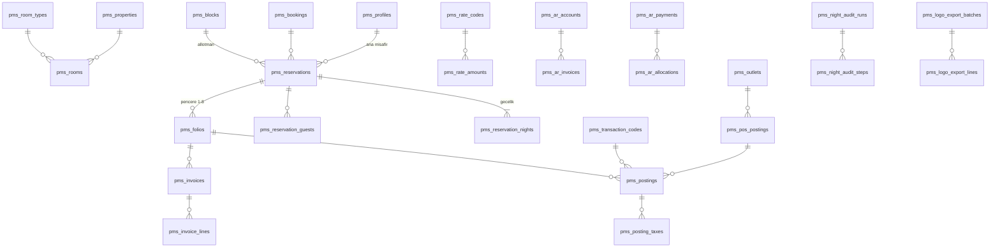

# 3. Veritabanı tasarımı

MySQL 8, InnoDB, `utf8mb4_unicode_ci`. Tüm iş tabloları **`pms_`** önekiyle (RS ONE ile birleşmede çakışma olmasın diye).
Laravel'in kendi tabloları (`users`, `jobs`, `cache`, `sessions`, `failed_jobs`, `personal_access_tokens`) öneksiz kalır.

## 3.0 Ortak kurallar

| Kural | Açıklama |
|---|---|
| Birincil anahtar | `id BIGINT UNSIGNED AUTO_INCREMENT` |
| Zaman | `created_at`, `updated_at` (`TIMESTAMP`); tanım tablolarında `deleted_at` (yumuşak silme) |
| Kim yaptı | `created_by`, `updated_by` → `users.id` (gerektiği tablolarda) |
| Tesis | İş tablolarında `property_id` → `pms_properties.id`, sorgularda her zaman ilk filtre |
| Para | `DECIMAL(14,2)`, kur `DECIMAL(18,8)`, oran `DECIMAL(8,4)`; para birimi `CHAR(3)` |
| Tarih | Konaklama ve iş günü `DATE`; anlık olaylar `TIMESTAMP` |
| Durum alanları | `VARCHAR(20)` + uygulamada PHP enum (MySQL `ENUM` kullanılmaz; yeni değer eklemek migration gerektirmesin) |
| Mali tablolar | `pms_postings`, `pms_posting_taxes`, `pms_invoices`, `pms_invoice_lines`, `pms_ar_*`, `pms_logo_export_*`: **silme yok, değiştirme yok**; yalnız ters kayıt |
| Dış kaynaklı kayıt | `idempotency_key VARCHAR(100) UNIQUE NULL` |
| Eski sistem | Aktarılan kayıtlarda `legacy_system VARCHAR(20)`, `legacy_id VARCHAR(50)` + birleşik indeks |
| Kişisel veri | Kimlik no, kart bilgisi şifreli (`encrypted` cast); aranacak alanların yanında `*_hash` (SHA-256) |

Aşağıda tablolar **modül modül** verilmiştir. Gösterim: `kolon  TİP  [boş olabilir?]  — açıklama`.
`FK` yabancı anahtar, `UQ` benzersiz, `IX` indeks.

---

## A. Çekirdek

### pms_properties — Tesisler
```
id
code                 VARCHAR(10)   UQ        — Kısa kod (RCK)
name                 VARCHAR(150)
legal_name           VARCHAR(200)  null      — Fatura üzerindeki ünvan
tax_office           VARCHAR(100)  null
tax_number           VARCHAR(30)   null
address              VARCHAR(500)  null
city                 VARCHAR(100)  null
country_code         CHAR(2)                 — CY / TR
phone, email, website VARCHAR      null
timezone             VARCHAR(50)             — Asia/Nicosia
base_currency        CHAR(3)                 — Tesis ana para birimi (TRY)
check_in_time        TIME                    — Standart giriş saati
check_out_time       TIME
current_business_date DATE                   — Açık iş günü (gece kapanışı ilerletir)
night_audit_time     TIME          null      — Otomatik kapanış saati (boşsa yalnız elle)
star_rating          TINYINT       null
rsone_business_id    BIGINT        null      — RS ONE businesses.id
is_active            BOOLEAN
timestamps, deleted_at
```

### users (Laravel) — Kullanıcılar
```
id, name, email UQ, password, phone null, locale (tr), is_active,
last_login_at null, rsone_user_id null, remember_token, timestamps
```

### pms_roles / pms_permissions / pms_role_permissions / pms_user_properties — Yetki
```
pms_roles:            id, code UQ (front_office, cashier, night_auditor, housekeeping, revenue, accounting, manager, admin), name
pms_permissions:      id, code UQ (folio.post, folio.reverse, folio.transfer, rate.override, reservation.cancel,
                      night_audit.run, cashier.close, ar.allocate, room.move, profile.merge, ...), name, group
pms_role_permissions: role_id FK, permission_id FK                         UQ(role_id, permission_id)
pms_user_properties:  id, user_id FK, property_id FK, role_id FK,
                      max_discount_pct DECIMAL(5,2) null, max_reversal_amount DECIMAL(14,2) null   — kişi bazlı sınır
                                                                            UQ(user_id, property_id, role_id)
```

### pms_settings — Ayarlar
```
id, property_id null (null = genel), key VARCHAR(100), value JSON, updated_by, timestamps   UQ(property_id, key)
```

### pms_business_dates — İş günleri
```
id
property_id          FK
business_date        DATE                    UQ(property_id, business_date)
status               VARCHAR(20)             — open / closing / closed
opened_at            TIMESTAMP
closed_at            TIMESTAMP     null
closed_by            FK users      null
night_audit_run_id   FK            null
```

### pms_currencies / pms_exchange_rates — Döviz
```
pms_currencies:      code CHAR(3) PK, name, symbol, decimals TINYINT, is_active
pms_exchange_rates:  id, property_id FK, currency_code FK, business_date DATE,
                     buy_rate, sell_rate, posting_rate DECIMAL(18,8)  — folyoda kullanılan kur,
                     source VARCHAR(20) (manual / central_bank), created_by, timestamps
                     UQ(property_id, currency_code, business_date)
```

### pms_taxes — Vergiler
```
id, property_id FK, code VARCHAR(10), name,
calc_type            VARCHAR(20)             — percent / per_night / per_person_night
rate                 DECIMAL(8,4)  null      — Yüzde
amount               DECIMAL(14,2) null      — Sabit tutar (konaklama vergisi gibi)
is_inclusive         BOOLEAN                 — Fiyata dahil mi
logo_tax_code        VARCHAR(20)   null
valid_from, valid_to DATE          null
timestamps, deleted_at                       UQ(property_id, code)
```
> KKTC'deki güncel KDV ve konaklama vergisi oranları kurulumda girilecek; tasarım oranı sabitlemez.

### pms_number_sequences — Numara serileri
```
id, property_id FK,
type                 VARCHAR(30)             — invoice / credit_note / proforma / receipt / confirmation / folio / ar_invoice / cancellation
prefix               VARCHAR(10)   null
next_number          BIGINT
padding              TINYINT
reset_yearly         BOOLEAN
current_year         SMALLINT      null      UQ(property_id, type)
```
Numara alma: `SELECT … FOR UPDATE` ile, aynı işlem içinde; boşluk bırakmaz.

### pms_reason_codes — Gerekçe kodları
```
id, property_id FK,
category             VARCHAR(30)             — cancel / no_show / room_move / rate_override / posting_reversal /
                                               discount / outage / waive / complimentary / early_departure
code VARCHAR(10), name, requires_note BOOLEAN, is_active                UQ(property_id, category, code)
```

### pms_countries — Ülkeler
```
code CHAR(2) PK, name_tr, name_en, nationality_tr, kbs_code VARCHAR(10) null, phone_prefix
```

### pms_audit_logs — Denetim kaydı
```
id, property_id null, user_id null,
auditable_type VARCHAR(100), auditable_id BIGINT,
action               VARCHAR(30)             — created / updated / deleted / status_changed / reversed / printed / exported
old_values, new_values JSON null
reason_code_id FK null, note VARCHAR(500) null,
business_date DATE null, ip VARCHAR(45), user_agent VARCHAR(255), created_at
IX(auditable_type, auditable_id), IX(property_id, created_at)
```

---

## B. Oda envanteri

### pms_buildings / pms_floors
```
pms_buildings: id, property_id FK, code, name, sort, timestamps, deleted_at          UQ(property_id, code)
pms_floors:    id, property_id FK, building_id FK null, code, name, sort, timestamps UQ(property_id, building_id, code)
```

### pms_room_classes — Oda sınıfları (Standart, Suit, Villa)
```
id, property_id FK, code VARCHAR(10), name, sort, timestamps, deleted_at              UQ(property_id, code)
```

### pms_room_types — Oda tipleri
```
id
property_id          FK
room_class_id        FK            null
code                 VARCHAR(10)             UQ(property_id, code) — DBL, TRP, SUI
name                 VARCHAR(100)
short_name           VARCHAR(30)   null
description          TEXT          null
default_adults       TINYINT                 — Fiyatın baz aldığı kişi sayısı
max_adults           TINYINT
max_children         TINYINT
max_occupancy        TINYINT
max_extra_beds       TINYINT
bed_type             VARCHAR(30)   null
size_m2              DECIMAL(6,2)  null
view                 VARCHAR(50)   null
color                CHAR(7)       null      — Oda planında renk
is_pseudo            BOOLEAN                 — Sanal (PM) oda tipi; satılmaz, envantere girmez
is_bookable_online   BOOLEAN
sort                 SMALLINT
is_active            BOOLEAN
timestamps, deleted_at
```

### pms_rooms — Odalar
```
id
property_id          FK
room_type_id         FK
building_id          FK            null
floor_id             FK            null
hk_section_id        FK            null      — Kat hizmetleri bölümü
number               VARCHAR(10)             UQ(property_id, number)
name                 VARCHAR(100)  null
description          VARCHAR(500)  null
max_occupancy        TINYINT       null      — Odaya özel sınır (boşsa tipten)
hk_credits           DECIMAL(4,1)            — Temizlik puanı (görev dağıtımı)
is_pseudo            BOOLEAN                 — PM / master / house odası
is_smoking           BOOLEAN
is_accessible        BOOLEAN
fo_status            VARCHAR(20)             — vacant / occupied        (önbellek, rezervasyondan türetilir)
hk_status            VARCHAR(20)             — clean / dirty / inspected / pickup
service_status       VARCHAR(20)             — in_service / out_of_order / out_of_service
current_reservation_id FK          null      — Şu an içerideki rezervasyon (önbellek)
hk_status_changed_at TIMESTAMP     null
sort                 SMALLINT
is_active            BOOLEAN
timestamps, deleted_at
IX(property_id, room_type_id), IX(property_id, hk_status)
```

### pms_room_features / pms_room_feature_room — Oda özellikleri
```
pms_room_features:     id, property_id FK, code, name (Deniz manzarası, Balkon, Küvet...)
pms_room_feature_room: room_id FK, room_feature_id FK      PK(room_id, room_feature_id)
```

### pms_room_connections — Bağlantılı odalar (QloApps)
```
id, room_id FK, connected_room_id FK, created_at          UQ(room_id, connected_room_id)  — iki yönlü kaydedilir
```

### pms_room_outages — Arızalı / kullanım dışı odalar
```
id, property_id FK, room_id FK,
type                 VARCHAR(5)              — ooo (envanterden düşer) / oos (satılabilir, uyarı)
date_from            DATE
date_to              DATE                    — Hariç (çıkış mantığı)
reason_code_id       FK
note                 VARCHAR(500)  null
return_hk_status     VARCHAR(20)             — Bitince oda durumu (dirty / clean)
rsone_task_id        BIGINT        null      — RS ONE teknik servis kaydı
released_at, released_by           null
created_by, timestamps
IX(property_id, date_from, date_to)
```

### pms_media — Görseller
```
id, property_id FK, mediable_type, mediable_id, path, category, caption null, sort, timestamps
```

---

## C. Kodlar (Fidelio mantığı)

```
pms_market_groups:     id, property_id, code, name, sort                                  — Bireysel / Grup / Kurumsal
pms_market_segments:   id, property_id, market_group_id FK, code, name, is_active, sort   — Segment (istatistik)
pms_source_codes:      id, property_id, code, name, channel VARCHAR(20)                   — direct / phone / web / ota / agency / walk_in / rsone
pms_reservation_types: id, property_id, code, name,
                       deducts_inventory BOOLEAN  — Envanterden düşer mi (opsiyon/kesin)
                       is_guaranteed BOOLEAN, requires_deposit BOOLEAN,
                       release_hour TIME null     — 18:00 rezervasyonu gibi
pms_vip_levels:        id, property_id, code, name, color
pms_special_requests:  id, property_id, category VARCHAR(30), code, name                  — Tercih ve istek listesi
```
Hepsinde: `timestamps, deleted_at`, `UQ(property_id, code)`.

---

## D. Profiller

### pms_profiles — Misafir, şirket, acente, kaynak, grup
```
id
property_id          FK            null      — null: tüm tesislerde ortak (zincir)
type                 VARCHAR(20)             — individual / company / travel_agent / source / group / contact
status               VARCHAR(20)             — active / inactive / blacklisted
title                VARCHAR(20)   null
first_name           VARCHAR(100)  null
middle_name          VARCHAR(100)  null
last_name            VARCHAR(100)  null
company_name         VARCHAR(200)  null      — Şirket / acente / grup adı
display_name         VARCHAR(250)            — Aramada kullanılan birleşik ad
gender               VARCHAR(10)   null
birth_date           DATE          null
birth_place          VARCHAR(100)  null
nationality_code     CHAR(2)       null
language_code        CHAR(2)       null
vip_level_id         FK            null
tax_office           VARCHAR(100)  null
tax_number           VARCHAR(30)   null      — Şirket/acente vergi no
iata_code            VARCHAR(20)   null      — Acente
commission_pct       DECIMAL(5,2)  null      — Acente komisyonu
ar_account_id        FK            null      — Cari hesabı (şirket/acente)
default_rate_code_id FK            null
default_market_segment_id FK       null
default_source_code_id    FK       null
blacklist_reason     VARCHAR(500)  null
marketing_consent    BOOLEAN
marketing_consent_at TIMESTAMP     null
privacy_notice_at    TIMESTAMP     null      — Aydınlatma metni onayı
rsone_client_id      BIGINT        null      — RS ONE clients.id
merged_into_id       FK self       null      — Birleştirilen mükerrer kayıt
legacy_system, legacy_id           null
created_by, updated_by, timestamps, deleted_at
IX(property_id, type, display_name), IX(last_name, first_name), IX(tax_number), IX(rsone_client_id), IX(legacy_system, legacy_id)
FULLTEXT(display_name)
```

### Profil alt tabloları
```
pms_profile_addresses:      id, profile_id FK, type (home/business/billing), line1, line2 null, district null,
                            city null, postal_code null, country_code, is_primary
pms_profile_communications: id, profile_id FK, type (mobile/phone/email/fax/web), value,
                            value_normalized  — E.164 telefon / küçük harf e-posta (RS ONE eşleşmesi)
                            is_primary, marketing_allowed                          IX(value_normalized)
pms_profile_identities:     id, profile_id FK, document_type (kktc_id/tc_id/passport/id_card/driving_license),
                            document_number (şifreli), document_number_hash, issuing_country, issue_place null,
                            issue_date null, expiry_date null, file_path null (şifreli depolama),
                            verified_at null, verified_by null                     IX(document_number_hash)
pms_profile_relations:      id, profile_id FK, related_profile_id FK, relation (employee_of/booker_for/spouse/child/assistant)
pms_profile_preferences:    id, profile_id FK, special_request_id FK, note null
pms_profile_memberships:    id, profile_id FK, program, number, level null, valid_until null
pms_profile_negotiated_rates: id, profile_id FK, property_id FK, rate_code_id FK, valid_from null, valid_to null
pms_profile_notes:          id, profile_id FK, area (general/front_office/housekeeping/accounting/sales),
                            note TEXT, is_internal, created_by, timestamps
pms_profile_stats:          profile_id PK, first_stay_date, last_stay_date, stays, nights, room_revenue,
                            other_revenue, total_revenue, cancellations, no_shows, updated_at
                            — Gece kapanışında güncellenir; Fidelio geçmişi de buraya toplanır
```

---

## E. Fiyat ve müsaitlik

### pms_seasons / pms_season_dates
```
pms_seasons:      id, property_id, code, name, color, sort
pms_season_dates: id, season_id FK, date_from DATE, date_to DATE                     IX(date_from, date_to)
```

### pms_rate_categories — Fiyat kategorileri (BAR, Kurumsal, Acente, Paket)
```
id, property_id, code, name, sort
```

### pms_rate_codes — Fiyat kodları
```
id
property_id          FK
rate_category_id     FK            null
code                 VARCHAR(20)             UQ(property_id, code)
name                 VARCHAR(100)
description          TEXT          null
currency_code        CHAR(3)
package_id           FK            null      — Pansiyon (BB, HB, FB, AI)
is_tax_inclusive     BOOLEAN
is_public            BOOLEAN                 — Çevrimiçi satışta görünür
is_negotiated        BOOLEAN                 — Yalnız anlaşmalı profillere
parent_rate_code_id  FK self       null      — Türetilmiş fiyat
derive_type          VARCHAR(10)   null      — percent / amount
derive_value         DECIMAL(14,2) null      — −10 (%10 indirim) gibi
rounding             VARCHAR(10)   null      — none / 1 / 5 / 10
room_transaction_code_id FK                  — Oda geliri işlem kodu
default_market_segment_id, default_source_code_id FK null
cancellation_policy_id, deposit_policy_id      FK null
min_los, max_los     SMALLINT      null
valid_from, valid_to DATE          null
is_active, sort, timestamps, deleted_at
```

### pms_rate_code_room_types — Fiyat kodunun sattığı oda tipleri
```
rate_code_id FK, room_type_id FK                                           PK(rate_code_id, room_type_id)
```

### pms_rate_amounts — Fiyat tablosu
```
id
rate_code_id         FK
room_type_id         FK
date_from, date_to   DATE                    — Dahil
weekdays             TINYINT                 — Bit maskesi: Pzt=1 … Paz=64; 127 = her gün
price_1, price_2, price_3, price_4  DECIMAL(14,2) null — 1..4 yetişkin fiyatı (oda başı)
extra_adult          DECIMAL(14,2) null
child_band_1, child_band_2, child_band_3  DECIMAL(14,2) null — Yaş bandına göre çocuk fiyatı
extra_bed            DECIMAL(14,2) null
created_by, timestamps
IX(rate_code_id, room_type_id, date_from, date_to)
```
Çözüm kuralı: Tarihi kapsayan, haftanın gününe uyan **en dar** aralık; eşitse **en son eklenen**.
Türetilmiş fiyat kodunda tablo boşsa üst koddan hesaplanır.

### pms_child_age_bands
```
id, property_id, band TINYINT (1-3), age_from TINYINT, age_to TINYINT, name     UQ(property_id, band)
```

### pms_packages / pms_package_elements — Pansiyon ve ek paketler
```
pms_packages:         id, property_id, code (BB/HB/FB/AI/SPA1), name,
                      type (board/addon), posting_rhythm (every_night/arrival/departure/once),
                      is_included_in_rate BOOLEAN   — Oda fiyatının içinden mi ayrılır
                      timestamps, deleted_at
pms_package_elements: id, package_id FK, transaction_code_id FK  — Kahvaltı geliri gibi
                      calc (per_room/per_person/per_adult/per_child), amount_adult, amount_child,
                      is_allowance BOOLEAN          — Hak; Simphony'de kullanıldıkça düşülür
                      outlet_id FK null             — Hakkın kullanılabileceği outlet
```
Gece kapanışında paketli oda ücreti: *oda geliri = gecelik fiyat − paket elemanları*; her eleman kendi işlem koduna ayrı kayıt.

### pms_rate_restrictions — Günlük kısıtlar
```
id, property_id, rate_code_id FK null, room_type_id FK null, date DATE,
is_closed, closed_to_arrival, closed_to_departure BOOLEAN,
min_los, max_los, min_advance_days, max_advance_days SMALLINT null, updated_by, timestamps
UQ(property_id, rate_code_id, room_type_id, date)
```

### pms_inventory_daily — Günlük müsaitlik (önbellek tablosu)
```
id, property_id, room_type_id FK, date DATE,
physical_rooms       SMALLINT                — Aktif oda sayısı
out_of_order         SMALLINT
sold_definite        SMALLINT                — Envanterden düşen rezervasyonlar
sold_tentative       SMALLINT                — Opsiyonlar (envanterden düşmeyen)
block_remaining      SMALLINT                — Allotmanda kalan, kullanılmamış
overbooking_limit    SMALLINT
available            SMALLINT                — physical − ooo − definite − block_remaining
updated_at
UQ(property_id, room_type_id, date)
```
Rezervasyon/blok/arıza her değiştiğinde aynı işlem içinde güncellenir; `pms:rebuild-inventory` komutu sıfırdan hesaplar.

### pms_cancellation_policies / pms_deposit_policies
```
pms_cancellation_policies:      id, property_id, code, name, description
pms_cancellation_policy_rules:  id, policy_id FK, days_before_arrival SMALLINT, hour TIME null,
                                penalty_type (nights/percent/amount), penalty_value, applies_to_no_show BOOLEAN
pms_deposit_policies:           id, property_id, code, name
pms_deposit_policy_rules:       id, policy_id FK, due_type (on_booking/days_before_arrival), due_days,
                                amount_type (percent/nights/amount), amount_value
```

---

## F. Rezervasyon

### pms_bookings — Çok odalı rezervasyon başlığı
```
id, property_id, booking_number UQ, booker_profile_id FK null, booker_name, booker_phone, booker_email,
source_code_id FK null, channel, external_reference null, notes TEXT null, created_by, timestamps
```

### pms_reservations — Rezervasyonlar (oda başına bir kayıt)
```
id
property_id          FK
booking_id           FK            null
confirmation_number  VARCHAR(20)             UQ(property_id, confirmation_number)
external_reference   VARCHAR(100)  null      — Acente voucher / OTA no
status               VARCHAR(20)             — inquiry / tentative / confirmed / waitlist / in_house /
                                               checked_out / cancelled / no_show
reservation_type_id  FK
-- Kişiler
profile_id           FK                      — Ana misafir
company_profile_id   FK            null
agent_profile_id     FK            null
source_profile_id    FK            null
group_profile_id     FK            null
block_id             FK            null      — Allotman / grup bloğu
share_group_id       BIGINT        null      — Aynı odayı paylaşan rezervasyonlar
-- Tarih
arrival_date         DATE
departure_date       DATE
nights               SMALLINT
eta, etd             TIME          null
checked_in_at, checked_out_at       TIMESTAMP null
check_in_business_date, check_out_business_date DATE null
option_date          DATE          null      — Opsiyon bitişi (tentative)
-- Oda
room_type_id         FK                      — Rezerve edilen tip
charge_room_type_id  FK                      — Ücretlendirilen tip (upgrade'de farklı)
room_id              FK            null
is_room_locked       BOOLEAN                 — Oda değiştirilemez
adults, children, infants, extra_beds  TINYINT
child_ages           JSON          null
-- Fiyat
rate_code_id         FK
currency_code        CHAR(3)
is_rate_overridden   BOOLEAN
total_room_amount    DECIMAL(14,2)           — Önbellek (gecelik satırların toplamı)
total_package_amount DECIMAL(14,2)
is_complimentary, is_house_use BOOLEAN
-- Pazar
market_segment_id    FK
source_code_id       FK
channel              VARCHAR(20)
vip_level_id         FK            null
-- Garanti / ödeme
guarantee_type       VARCHAR(20)             — none / card / deposit / company / agent
payment_token_id     FK            null
deposit_required     DECIMAL(14,2)
deposit_due_date     DATE          null
room_charges_allowed BOOLEAN                 — Oda hesabına harcama (Simphony/RS ONE) yazılabilir mi
credit_limit         DECIMAL(14,2) null
payment_instructions VARCHAR(500)  null
-- İptal / no-show
cancellation_policy_id FK          null
cancelled_at         TIMESTAMP     null
cancelled_by         FK            null
cancel_reason_code_id FK           null
cancellation_number  VARCHAR(20)   null
no_show_at           TIMESTAMP     null
waitlist_priority    SMALLINT      null
-- Diğer
is_walk_in, is_day_use BOOLEAN
guest_comments       TEXT          null
internal_notes       TEXT          null
legacy_system, legacy_id           null
created_by, updated_by, timestamps
IX(property_id, arrival_date), IX(property_id, departure_date), IX(property_id, status),
IX(room_id, arrival_date), IX(profile_id), IX(block_id), IX(company_profile_id), IX(agent_profile_id)
```

### pms_reservation_nights — Gecelik satırlar (fiyat, tip, oda)
```
id
reservation_id       FK
property_id          FK
stay_date            DATE                    UQ(reservation_id, stay_date)
room_type_id         FK
room_id              FK            null      — Konaklama içinde oda değişirse geceye göre
rate_code_id         FK
adults, children     TINYINT
amount               DECIMAL(14,2)           — O gecenin fiyatı (paket dahil, vergi kurala göre)
package_amount       DECIMAL(14,2)
currency_code        CHAR(3)
is_overridden        BOOLEAN
override_reason_code_id FK         null
market_segment_id    FK
status               VARCHAR(20)             — expected / posted / cancelled
posted_posting_id    FK            null      — Gece kapanışında oluşan kayıt
IX(property_id, stay_date)
```
Fiyat, müsaitlik ve istatistik bu tablodan okunur (OCA/pms `reservation_line`, Kamra `reservation_night_rate`).

### Rezervasyon alt tabloları
```
pms_reservation_guests:     id, reservation_id FK, profile_id FK, role (primary/sharer/accompanying/child),
                            age TINYINT null, checked_in_at null, checked_out_at null
                            — Kimlik bildirimi her kişi için ayrı
pms_reservation_packages:   id, reservation_id FK, package_id FK, quantity, date_from, date_to, amount_override null
pms_reservation_status_logs: id, reservation_id FK, from_status, to_status, reason_code_id null, note null,
                            business_date, user_id, created_at
pms_reservation_room_moves: id, reservation_id FK, from_room_id, to_room_id, business_date,
                            reason_code_id, rate_changed BOOLEAN, user_id, created_at
pms_fixed_charges:          id, reservation_id FK, transaction_code_id FK, description, quantity, amount,
                            frequency (once/daily/weekly/arrival/departure), date_from, date_to,
                            folio_window TINYINT, last_posted_date null
pms_deposit_requests:       id, reservation_id FK, due_date, amount, currency_code,
                            status (pending/paid/cancelled), paid_posting_id FK null
pms_payment_tokens:         id, profile_id FK null, reservation_id FK null, provider, token (şifreli),
                            brand, last4 CHAR(4), expiry_month, expiry_year, holder_name
                            — Kart numarası ve CVV ASLA saklanmaz
```

### pms_traces — İzler (departmanlara tarihli not/görev)
```
id, property_id, traceable_type, traceable_id,
department (front_office/housekeeping/concierge/fnb/accounting/spa/maintenance),
trace_date DATE, trace_time TIME null, message VARCHAR(1000),
is_resolved, resolved_by null, resolved_at null, created_by, timestamps
IX(property_id, department, trace_date, is_resolved)
```

### pms_alerts — Uyarılar (girişte/çıkışta açılır)
```
id, alertable_type, alertable_id, area (check_in/check_out/reservation/any), message, is_active, created_by, timestamps
```

### pms_blocks / pms_block_inventory — Grup ve allotman
```
pms_blocks:          id, property_id, code UQ, name, type (allotment/group),
                     status (inquiry/tentative/definite/cancelled),
                     profile_id FK (acente/şirket), group_profile_id FK null,
                     start_date, end_date, release_days SMALLINT, cutoff_date DATE null,
                     rate_code_id FK, market_segment_id FK, source_code_id FK,
                     deducts_inventory BOOLEAN, rooming_list_due DATE null, contract_number null,
                     notes TEXT null, created_by, timestamps, deleted_at
pms_block_inventory: id, block_id FK, room_type_id FK, date DATE,
                     allotted SMALLINT, picked_up SMALLINT (önbellek), released SMALLINT,
                     rate_override DECIMAL(14,2) null                  UQ(block_id, room_type_id, date)
```

---

## G. Kasa (folyo, kayıt, fatura)

### pms_transaction_code_groups — İşlem kodu grupları
```
id, property_id, parent_id FK self null, code, name,
type VARCHAR(20) — revenue / payment / non_revenue
sort                                                                     UQ(property_id, code)
```

### pms_transaction_codes — İşlem kodları (Fidelio departman kodları)
```
id
property_id          FK
group_id             FK
code                 VARCHAR(10)             UQ(property_id, code) — 1000 Konaklama, 2000 Restoran, 9000 Nakit...
name                 VARCHAR(100)
type                 VARCHAR(20)             — revenue / payment / paid_out / deposit / ar_transfer / internal
payment_kind         VARCHAR(20)   null      — cash / card / bank_transfer / city_ledger / voucher / foreign_cash
currency_code        CHAR(3)       null      — Döviz nakit kodları için
revenue_bucket       VARCHAR(20)   null      — room / fnb / spa / other  (istatistik)
is_tax_inclusive     BOOLEAN
default_price        DECIMAL(14,2) null
manual_post_allowed  BOOLEAN                 — Kullanıcı elle girebilir mi
outlet_id            FK            null
is_active, sort, timestamps, deleted_at
```

### pms_transaction_code_taxes
```
id, transaction_code_id FK, tax_id FK, sequence TINYINT, calc_base (net/net_plus_previous)
```

### pms_folios — Folyolar
```
id
property_id          FK
folio_number         VARCHAR(20)             UQ(property_id, folio_number)
type                 VARCHAR(20)             — guest / master / passer_by / pseudo_room / house_account / ar
reservation_id       FK            null
window               TINYINT                 — 1..8 (Fidelio pencere)       UQ(reservation_id, window)
payee_profile_id     FK            null      — Bu pencereyi kim öder
ar_account_id        FK            null
status               VARCHAR(20)             — open / closed
balance              DECIMAL(14,2)           — Önbellek; kayıt atılırken kilitli güncellenir
opened_business_date DATE
closed_business_date DATE          null
closed_by            FK            null
notes                VARCHAR(500)  null
timestamps
```

### pms_routing_rules — Yönlendirme (oda şirkete, ekstralar misafire)
```
id, property_id,
source_reservation_id FK
target_type          VARCHAR(20)             — window / reservation / folio
target_window        TINYINT       null
target_reservation_id FK           null
target_folio_id      FK            null
transaction_code_id  FK            null      — Belirli kod veya
transaction_code_group_id FK       null      — kod grubu (ikisi de boşsa: tümü)
date_from, date_to   DATE          null
credit_limit         DECIMAL(14,2) null
is_active, created_by, timestamps
```

### pms_postings — Folyo kayıtları (sistemin kalbi)
```
id
property_id          FK
business_date        DATE                    — Kaydın ait olduğu iş günü
folio_id             FK
reservation_id       FK            null      — Kopya (hızlı sorgu)
room_id              FK            null      — Kayıt anındaki oda (anlık görüntü)
transaction_code_id  FK
ledger               VARCHAR(10)             — guest / deposit / ar / package
kind                 VARCHAR(20)             — charge / payment / adjustment / transfer / deposit /
                                               deposit_transfer / paid_out / exchange / allowance
description          VARCHAR(255)
reference            VARCHAR(100)  null      — Fiş no, slip no
quantity             DECIMAL(10,2)
unit_price           DECIMAL(14,2)
amount               DECIMAL(14,2)           — İşaretli: harcama +, ödeme −   (tesis para biriminde, vergi dahil)
net_amount           DECIMAL(14,2)
tax_amount           DECIMAL(14,2)
foreign_currency     CHAR(3)       null
foreign_amount       DECIMAL(14,2) null
exchange_rate        DECIMAL(18,8) null
stay_date            DATE          null      — Oda ücretinin ait olduğu gece
reservation_night_id FK            null
package_id           FK            null
outlet_id            FK            null
pos_posting_id       FK            null      — Simphony'den geldiyse
pos_check_number     VARCHAR(30)   null
source               VARCHAR(20)             — manual / night_audit / fixed_charge / simphony / rsone / transfer / import
cashier_shift_id     FK            null
posted_by            FK users
reversal_of_id       FK self       null      — Bu kayıt neyin tersi
reversed_by_id       FK self       null      — Bu kaydı kim ters çevirdi
transfer_from_id     FK self       null      — Başka folyodan aktarıldıysa
reason_code_id       FK            null
note                 VARCHAR(500)  null
invoice_id           FK            null      — Faturaya girdiğinde dolar
idempotency_key      VARCHAR(100)  null      UQ
created_at
IX(folio_id), IX(property_id, business_date), IX(transaction_code_id, business_date), IX(reservation_id), IX(outlet_id, business_date)
```
Kurallar:
- Güncellenebilen alanlar yalnız `reversed_by_id` ve `invoice_id`.
- Folyo bakiyesi = `SUM(amount)`; `pms_folios.balance` aynı işlemde güncellenir, gece kapanışında doğrulanır.
- Transfer: kaynak folyoya ters kayıt + hedef folyoya yeni kayıt (`transfer_from_id`), ikisi aynı işlemde.

### pms_posting_taxes
```
id, posting_id FK, tax_id FK, rate DECIMAL(8,4), base_amount, tax_amount
```

### pms_invoices / pms_invoice_lines — Faturalar
```
pms_invoices:
  id, property_id, invoice_number UQ(property_id, invoice_number), series VARCHAR(10),
  type                (invoice / proforma / credit_note)
  status              (issued / cancelled)
  folio_id FK, reservation_id FK null, bill_to_profile_id FK null,
  bill_to_name, bill_to_tax_office, bill_to_tax_number, bill_to_address   — Anlık görüntü
  business_date, issued_at, issued_by,
  currency_code, total_net, total_tax, total_gross, total_paid,
  credit_note_for_id FK self null, replaces_invoice_id FK self null,
  cancelled_at null, cancelled_by null, cancel_reason_code_id null,
  print_count SMALLINT, pdf_path null, e_document_uuid null (ileride e-fatura için)
pms_invoice_lines:
  id, invoice_id FK, posting_id FK null, transaction_code_id FK, description,
  stay_date null, quantity, unit_price, net_amount, tax_amount, gross_amount, tax_breakdown JSON
```

### pms_cashiers / pms_cashier_shifts / pms_cashier_shift_totals — Kasa
```
pms_cashiers:            id, property_id, number SMALLINT, name, user_id FK null, is_active   UQ(property_id, number)
pms_cashier_shifts:      id, property_id, cashier_id FK, business_date, status (open/closed),
                         opened_at, opened_by, closed_at null, closed_by null, notes null
pms_cashier_shift_totals: id, shift_id FK, transaction_code_id FK (ödeme kodu), currency_code,
                         opening_amount, system_amount, counted_amount, difference
```

---

## H. Cari hesaplar (City Ledger)

```
pms_ar_accounts:    id, property_id, account_number UQ, profile_id FK (şirket/acente), name,
                    status (active/on_hold/closed), credit_limit, payment_terms_days,
                    currency_code, statement_email null, logo_cari_code VARCHAR(30) — Logo cari kodu,
                    contact_name, contact_phone, notes, timestamps, deleted_at
pms_ar_invoices:    id, property_id, ar_account_id FK, invoice_id FK null, folio_id FK null,
                    business_date, document_date, due_date, amount, open_amount (önbellek), currency_code,
                    status (open/partially_paid/paid/disputed/written_off), reference null,
                    dispute_note null, created_by, timestamps
pms_ar_payments:    id, property_id, ar_account_id FK, business_date, payment_date,
                    transaction_code_id FK, amount, unallocated_amount, currency_code, exchange_rate null,
                    reference null, cashier_shift_id FK null, posted_by, reversal_of_id FK self null, created_at
pms_ar_allocations: id, ar_payment_id FK, ar_invoice_id FK, amount, allocated_by, created_at,
                    reversed_at null, reversed_by null
pms_ar_statements:  id, ar_account_id FK, statement_date, period_from, period_to,
                    opening_balance, closing_balance, file_path null, sent_at null, created_by
```
Folyodan cariye aktarım: folyoda `payment_kind = city_ledger` ödeme kaydı (`ledger = guest`) + karşılığında `pms_ar_invoices` satırı (`ledger = ar`).

---

## I. Gece kapanışı ve istatistik

```
pms_night_audit_runs:   id, property_id, business_date, status (running/completed/failed/held),
                        trigger (manual/scheduled), run_by FK null, started_at, finished_at null,
                        current_step VARCHAR(40) null, exceptions_count SMALLINT,
                        report_pack LONGTEXT (JSON)  — Günün raporları, sonradan değişmez
                        notes TEXT null                                    UQ(property_id, business_date)
pms_night_audit_steps:  id, run_id FK, code, sequence, status (pending/running/done/failed/skipped),
                        started_at, finished_at, result JSON null, error TEXT null
pms_night_audit_checks: id, run_id FK, code, severity (block/warn/info), items_count, items JSON,
                        acknowledged_by null, acknowledged_reason null
pms_daily_statistics:   id, property_id, business_date,
                        dimension VARCHAR(20)  — total / room_type / market_segment / source / rate_code /
                                                 nationality / agent / company
                        dimension_key VARCHAR(50),
                        rooms_available, rooms_ooo, rooms_sold, rooms_comp, rooms_house_use,
                        adults, children, arrivals, departures, no_shows, cancellations, walk_ins,
                        room_revenue, fnb_revenue, other_revenue, total_revenue,   — net
                        occupancy_pct, adr, revpar                    UQ(property_id, business_date, dimension, dimension_key)
pms_daily_revenue:      id, property_id, business_date, transaction_code_id FK, outlet_id FK null,
                        postings_count, net_amount, tax_amount, gross_amount     — Logo'ya kaynak
pms_ledger_balances:    id, property_id, business_date, ledger (guest/deposit/ar/package),
                        opening, debits, credits, closing                — Günlük defter dengesi
```

### Gece kapanışı adımları
| # | Adım | Ne yapar |
|---|---|---|
| 1 | Ön kontroller | Açık kasa, kapanmamış Simphony hesabı, çıkışı geçmiş misafir, gelmeyen misafir, fiyat sapması, yüksek bakiye, kredi limiti, oda durumu uyuşmazlığı (*engeller / uyarır / bilgi*) |
| 2 | No-show | Gelmeyen garantili rezervasyonları no-show yapar, iptal politikasına göre ceza kaydı |
| 3 | Opsiyon ve allotman | Süresi dolan opsiyonları iptal eder, release günü gelen blokları serbest bırakır |
| 4 | Oda ücretleri | İçerideki her rezervasyon için `pms_reservation_nights` → `pms_postings` (paket elemanları ayrı) |
| 5 | Sabit ücretler | `pms_fixed_charges` |
| 6 | Oda durumu | Dolu odaları *kirli* yapar |
| 7 | İstatistik | `pms_daily_statistics`, `pms_daily_revenue`, `pms_ledger_balances`, `pms_profile_stats` |
| 8 | Raporlar | Rapor paketini (`report_pack`) üretir |
| 9 | Logo | Günün aktarım partilerini kuyruğa atar |
| 10 | İş günü | `current_business_date` +1, yeni `pms_business_dates` kaydı |

Her adım kaldığı yerden devam edebilir (yarıda kesilirse tekrar çalıştırmak çift kayıt üretmez — `idempotency_key = audit:{tarih}:{rezervasyon}:{gece}`).

---

## J. Kat hizmetleri

```
pms_hk_sections:     id, property_id, code, name, sort
pms_hk_attendants:   id, property_id, user_id FK null, name, is_active
pms_hk_assignments:  id, property_id, business_date, attendant_id FK, room_id FK,
                     task_type (departure/stayover/turndown/deep_clean/inspection),
                     status (pending/in_progress/done/inspected/skipped), credits,
                     started_at, finished_at, inspected_by null, note null, photo_path null, timestamps
                     IX(property_id, business_date, attendant_id)
pms_room_status_logs: id, property_id, room_id FK, field (hk_status/service_status/fo_status),
                     from_value, to_value, source (manual/check_out/night_audit/mobile/outage),
                     user_id null, created_at                         IX(room_id, created_at)
pms_room_discrepancies: id, property_id, business_date, room_id FK,
                     type (skip/sleep/person_count), fo_status, hk_reported_status,
                     fo_persons, hk_persons, resolved_by null, resolved_at null, note null
pms_lost_found:      id, property_id, room_id null, reservation_id null, profile_id null,
                     found_at, found_by, description, storage_location,
                     status (stored/returned/disposed), returned_at null, returned_to null, note null
```

---

## K. Simphony (ayrıntı: [Simphony belgesi](04-simphony.md))

```
pms_outlets:              id, property_id, code UQ(property_id, code), name,
                          type (restaurant/bar/room_service/minibar/spa/shop/other),
                          source_system (simphony/rsone/manual),
                          simphony_rvc_number INT null   — Simphony Revenue Center no
                          rsone_department_id BIGINT null,
                          default_transaction_code_id FK null, is_active, sort, timestamps
pms_pos_interfaces:       id, property_id, name, system (simphony), protocol (simphony_pms_tcp/fias/rest),
                          listen_host, listen_port, allowed_ips JSON, settings JSON (şifreli),
                          is_active, last_heartbeat_at null, timestamps
pms_pos_revenue_mappings: id, property_id, outlet_id FK null (null = tüm outlet'ler),
                          source_type (sales_itemizer/major_group/family_group/service_charge/discount/tax/tip),
                          source_code VARCHAR(30), source_name, transaction_code_id FK, timestamps
                          UQ(property_id, outlet_id, source_type, source_code)
pms_pos_tender_mappings:  id, property_id, outlet_id FK null, tender_number INT, tender_name,
                          kind (room_charge/cash/card/city_ledger/comp/other), transaction_code_id FK null
pms_pos_messages:         id, property_id, interface_id FK, direction (in/out),
                          message_type (inquiry/posting/answer/link/heartbeat/error),
                          raw LONGTEXT, parsed JSON null, correlation_id null,
                          status (received/processed/failed), error null, created_at
                          IX(interface_id, created_at)                — 180 gün saklanır
pms_pos_postings:         id, property_id, interface_id FK, outlet_id FK, rvc_number, check_number,
                          workstation null, employee_number null, employee_name null, covers SMALLINT null,
                          pos_business_date null, business_date,
                          room_number, reservation_id FK null, folio_id FK null,
                          total_amount, subtotals JSON, tip_amount null,
                          status (accepted/rejected/reversed),
                          reject_reason (room_not_found/not_in_house/no_post/credit_limit/closed_day) null,
                          idempotency_key UQ, created_at
pms_pos_daily_sales:      id, property_id, outlet_id FK, pos_business_date, source (simphony_api/csv),
                          checks_count, covers, net_sales, tax, service_charge, discounts,
                          status (imported/verified/exported), imported_at, imported_by null
pms_pos_daily_sales_lines: id, daily_sales_id FK, line_type (revenue/tender/tax/discount/service),
                          source_code, source_name, transaction_code_id FK null, amount
```

---

## L. Logo (ayrıntı: [Logo belgesi](05-logo.md))

```
pms_logo_account_mappings: id, property_id, mappable_type (transaction_code/tax/ar_account/outlet/ledger),
                           mappable_id, logo_account_code, logo_cost_center null, logo_department null,
                           logo_project_code null, valid_from DATE null, timestamps
pms_logo_export_batches:   id, property_id, business_date,
                           type (daily_revenue/collections/ar_invoices/ar_payments/outlet_sales),
                           status (pending/sent/accepted/failed/cancelled),
                           logo_document_number null, attempts, sent_at null, response JSON null, error null,
                           replaces_batch_id FK self null, created_by null, timestamps
                           IX(property_id, business_date, type)
pms_logo_export_lines:     id, batch_id FK, line_no, account_code, cost_center null,
                           debit, credit, currency_code, foreign_amount null, exchange_rate null,
                           description, source_type null, source_id null
```

---

## M. Entegrasyon (RS ONE, kimlik bildirimi, eski sistem)

```
pms_external_refs:        id, entity_type, entity_id, system (rsone/fidelio/simphony/channel), external_id,
                          meta JSON null, timestamps            UQ(system, entity_type, external_id)
pms_outbox:               id, event (reservation.checked_in / checked_out / room_moved / profile.updated),
                          payload JSON, target (rsone), status (pending/sent/failed), attempts,
                          next_attempt_at, last_error null, timestamps
pms_guest_registrations:  id, property_id, reservation_id FK, reservation_guest_id FK, profile_id FK, room_id FK,
                          type (check_in/check_out/room_change), business_date,
                          status (pending/sent/failed/not_required), attempts, sent_at null,
                          response JSON null, error null, timestamps           — Kimlik bildirimi (KBS)
pms_legacy_import_batches: id, entity, source (fidelio), started_at, finished_at null,
                          total, imported, skipped, failed, log_path null, run_by
pms_legacy_import_errors: id, batch_id FK, legacy_id, error TEXT, payload JSON
```
API kimlik doğrulama: Laravel Sanctum (`personal_access_tokens`); RS ONE ve Simphony yardımcı servisleri için ayrı jeton.

---

## 3.1 Ana ilişkiler



## 3.2 Sayılar

| Modül | Tablo sayısı |
|---|---|
| A. Çekirdek (`users` dahil) | 15 |
| B. Envanter | 10 |
| C. Kodlar | 6 |
| D. Profiller | 10 |
| E. Fiyat ve müsaitlik | 15 |
| F. Rezervasyon | 14 |
| G. Kasa | 12 |
| H. Cari | 5 |
| I. Gece kapanışı | 6 |
| J. Kat hizmetleri | 6 |
| K. Simphony | 8 |
| L. Logo | 3 |
| M. Entegrasyon | 5 |
| **Toplam** | **115** |
